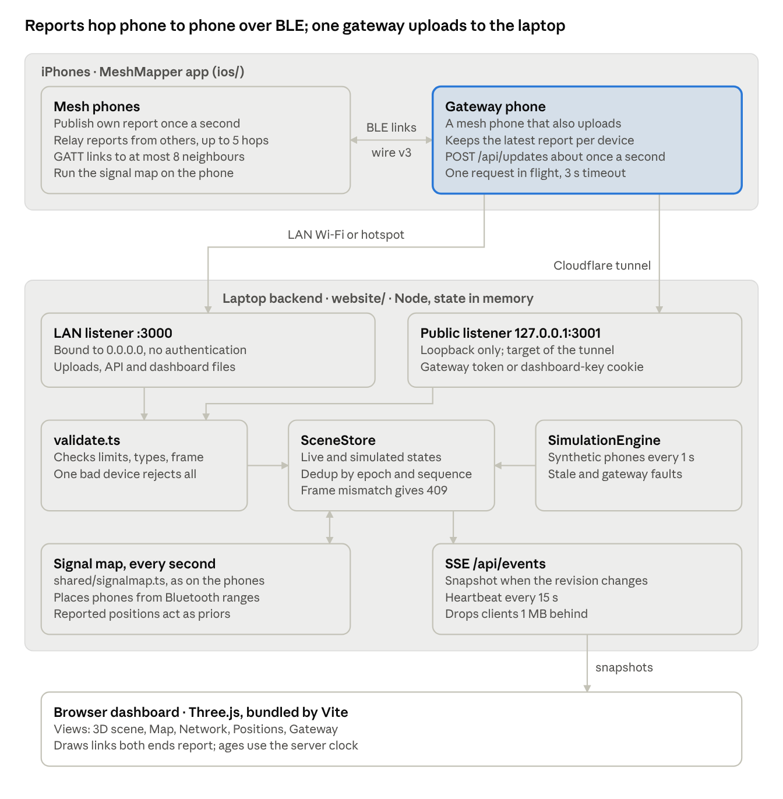

# Hackathonmapper: project overview

As of 25 October 2026. This describes `main` after pull request #13 (`d848682`): wire v5 with UWB
distances, the audit fixes, the signal map on the main map, the Track tab's distance methods and the
feature switches.
- For what the project is for (goals and non-goals), read [VISION.md](VISION.md).
- For what to do first (installing on phones, which build runs where), read [HANDOVER.md](HANDOVER.md).
- For what is inconsistent, duplicated or still open, read [docs/AUDIT.md](docs/AUDIT.md).

## What it is

A positioning network for when GNSS is unavailable or can't be trusted.
- Foreground iPhones form a Bluetooth LE mesh and relay each other's position reports.
- One phone, chosen by hand, is the **gateway**. It uploads the newest reports over HTTP to a laptop,
  which shows them live in a web dashboard. The laptop can also join the mesh itself over Web
  Bluetooth.
- Everything works offline.
- Phones without a position of their own are placed from the Bluetooth signal strength to phones that
  have one. Where both phones have UWB (iPhone 11 or newer, not SE), they use the UWB distance instead.

A report travels one way: origin phone → Bluetooth hops → gateway phone → `POST /api/updates` on the
laptop → Server-Sent Events to every open browser. The gateway reaches the laptop in one of two ways:
- On the LAN: port 3000, no secrets, local host names only.
- From anywhere, through a Cloudflare tunnel: port 3001, secrets required.

## State at a glance

| Area | Size | State |
|---|---|---|
| Dashboard and backend (`website/`) | ~7,500 lines of TypeScript | The typecheck and the signal-map, mesh-protocol and GhostCore contract checks pass. It runs live, simulated, and through the tunnel. Server probes show one bad request no longer stops it |
| iPhone app (`ios/`) | ~20,000 lines of Swift, ~5,700 lines of tests (303 tests in CI) | GitHub Actions builds and tests every push (`contract/validate.sh`: `swift test`, TypeScript checks, unsigned build). On phones: TestFlight 12 (wire v3); no v4 or v5 build installed yet |
| Android app (`android/`) | Kotlin / Jetpack Compose port of the iPhone app, with JUnit tests | Merged but behind: it speaks **wire v3**, so it cannot link with v5 iPhones or the dashboard node until ported. CI does not build it (`./gradlew` locally, JDK 17) |
| Movement and route models (`ml/`) | Python training, JSON weights, Swift and JS runtimes | Route model v3 drawn in the app as likely paths; the route filter is checked but not in the app |
| Field verification | | None. Fusion, UWB, the GhostCore engines and the signal map have not been checked on real phones, and the radio constants are defaults |

**Wire format v5.** Every phone and the dashboard's own mesh node must run the same version; the Hello
refuses any other. Build 13 (v4) was never installed. Skip it and install one v5 build on every phone.

## Repository map

| Folder | What | Language | Main doc |
|---|---|---|---|
| `website/` | Laptop backend (`server/`), dashboard (`src/`), code shared by both (`shared/`), check and demo scripts (`scripts/`) | TypeScript, Node 20+ | [WEBSITE_PLAN.md](WEBSITE_PLAN.md) |
| `ios/MeshCore/` | Swift package with everything testable without iOS frameworks: wire format, relay, signal map, fusion, UWB session policy, GhostCore (contract, GNSS integrity, positioning, relay records, Ghost prediction) | Swift | [app.md](app.md), [ARCHITECTURE.md](ARCHITECTURE.md) |
| `ios/MeshMapper/` | The app target: Core Bluetooth, Core Location, Core Motion, Nearby Interaction, SwiftUI | Swift | [app.md](app.md) |
| `android/` | Kotlin port of `ios/`: `meshcore/` (pure JVM, mirrors MeshCore, replays the Swift signal-map golden file) and `app/` (Compose). Wire v3 for now | Kotlin | [CLAUDE.md](CLAUDE.md), [android/PORTING.md](android/PORTING.md) |
| `contract/` | `validate.sh` (the gate CI runs), GhostCore golden fixtures, the GPS scenario runner | Shell, JSON | [ARCHITECTURE.md](ARCHITECTURE.md) §4, §7 |
| `ml/` | Movement model v2 and route model v3: data prep, training, export, runtimes, demo page | Python, JS, Swift | [ml/README.md](ml/README.md) |
| `ghost/` | Ghost Mode (where a lost phone probably is): fixtures, replay, held-out evaluation | JSON, shell | [ghost/README.md](ghost/README.md) |
| `tools/ble-mesh/` | Field-test helper for the BLE mesh protocol | Python | [BLE_MESH_TEST_PROTOCOL.md](BLE_MESH_TEST_PROTOCOL.md) |
| `docs/` | Design notes (GNSS integrity, ambient radio), this audit, and `history/` (past reviews) | Markdown | [Docs map](#docs-map) |
| `.github/workflows/ios.yml` | CI: gate on every push and PR, unsigned `.ipa` on every push, signed TestFlight upload on demand | YAML | [CLAUDE.md](CLAUDE.md) |

The root `package.json` forwards the `website/` scripts, so they also run from the repository root.
The unmerged `feature/eas-build` branch adds an alternative cloud build path (Expo EAS). It overlaps
with GitHub Actions.

## The iPhone app

The app opens on the **GhostUI map** (`PhoneMapView`). It shows this phone, every phone the mesh
reaches, and predicted areas and likely paths for phones that went silent. The gear button opens
Settings:
- Track (the signal map as a radar), Start, Network, Position and Gateway.
- The Relay test and Ambient radio screens.

Any phone becomes the gateway by scanning the dashboard's QR code.

What a phone **publishes** (`MeshModel.publishCurrent`), in order:
1. A fresh UWB fix from a mounted direction anchor, when UWB positioning is on.
2. The typed-in spot, when the position choice is manual.
3. `FusionEngine` (step counting plus RSSI to placed anchor phones), while fused tracking runs.
4. Otherwise what `GhostCorePipeline` allows: GPS (only trusted GPS with the GPS check on), or `none`,
   meaning "place me from Bluetooth".

Each report also carries the phone's direct neighbors with their RSSI and, on wire v5, the phone's own
UWB distance to each.

What the phone **draws** for other phones comes from the signal map, the same solver as the dashboard,
on both the main map (`SignalMapPositioning` in GhostCore's slot) and the Track tab. Its own marker on
the main map comes from GhostCore's `PositioningService`, which can differ from the `fused` position it
publishes (audit §1.2, still open).

The **Track tab** is the test bench for distance:
- Its radar can use UWB + Bluetooth (like the map), Bluetooth only or UWB only.
- "Distance methods" shows every method's distance to one linked phone side by side: UWB, the signal
  map, calibrated and default RSSI, GhostCore's median filter, and GPS.
- A tape-measure trial scores each method against a measured distance and exports the readings as CSV.

**Start → Features** switches features at runtime (`FeatureFlags`, persisted), so the phones need no
new build to compare them: motion and compass, the main map's placement engine (signal map, peer
locator, particle filter), its ranges and radio calibration, the prediction for silent phones (model,
walking circle, off), likely paths, fast updates (0.2 s or 1 s) and relaying GPS check records. The
table in app.md ("Feature switches") lists each with its default.

## Positioning: who does what

| Engine | Where | Places | Used for |
|---|---|---|---|
| Signal map (`SignalMap.swift` = `shared/signalmap.ts`, golden-tested) | Dashboard; app main map (`SignalMapPositioning`) and Track tab | Every phone, from RSSI ranges and UWB distances, with reported positions as priors | Dashboard positions; peer markers on the main map; Track tab |
| `FusionEngine` + `PositionFilter` (EKF) + `RangeSolver` | App | This phone | The published `fused` position |
| GhostCore `PositioningService` / `Positioning.Engine` | App | This phone | The self marker on the main map |
| `DistanceLab` | App (Track tab) | — | Compares every distance method on one link; tape-measure trials |
| GhostCore `PeerLocator` | App, when chosen | Other phones | Alternative main-map engine (Features → Placed by), RSSI only |
| `GNSSIntegrityMonitor` | App | — | Whether this phone's GPS is trusted (GPS check, off by default) |
| `GhostPredictor`, `MovementPredictor` (route model) | App | Silent phones | Predicted areas and likely paths |
| `UWBSessionPolicy` + `UWBRanging` | App | — | Which (at most four) neighbors get a UWB session |
| `BluetoothEstimator` (particle filter) | App, when chosen | Other phones | GhostCore's baseline engine; alternative main-map engine (Features → Placed by) |

The position sources on the wire are `gps`, `manual`, `fused`, `uwb` and `none`.
- Accuracy is always a 95 % radius.
- Manual and RSSI positions are never presented as measured.
- In the signal map, a phone in a UWB-linked group is never shown more precisely than the group's own
  placement allows.

## Contracts and mirrors

Two agreements hold the system together, and both sides check them:
- **Phone to phone (Bluetooth), wire v5.**
  - Typed frames: 1 Hello, 2 position, 3 ranging token, 4 ranging fix, 5–7 GhostCore relay.
  - A Hello per link carries the protocol version.
  - Relays keep the origin's id, epoch and sequence.
  - Defined in MeshCore and mirrored by `website/src/meshproto.ts` for the dashboard's own Web
    Bluetooth mesh node.
- **Gateway to laptop (HTTP).**
  - `UpdateBatch` in `website/shared/contract.ts`, enforced by `website/server/validate.ts`.
  - One invalid device rejects the whole batch, so the app checks the same limits first
    (`DashboardContract`).

| Swift | TypeScript | Kept in step by |
|---|---|---|
| `SignalMap.swift` | `shared/signalmap.ts` | `npm run signalmap:check -- --write-golden` + `SignalMapTests` |
| `MeshProtocol`, `Framing`, `MeshStore` | `src/meshproto.ts` | `npm run check:mesh` (in the gate, including the version) |
| `GhostCoreContract` | `shared/ghostcore.ts` | `npm run check:ghostcore` + `contract/fixtures` |
| `DashboardContract` | `contract.ts` limits, `validate.ts` | by hand |
| `RadioModel.standard` | `RADIO_MODEL` | by hand |
| `GeoFrame.origins` | `shared/geoframe.ts` | by hand |

## Dashboard and backend

A plain `node:http` server keeps everything in memory:
- Separate live and simulated states, merged by device id, epoch and sequence.
- Operator pins survive a restart.
- It runs the signal map every second and shortly after each upload. It pushes a snapshot over SSE
  only when something changed.

Views:
- a Three.js scene of phones and links;
- a 2D map: the same scene seen from above;
- Network, Positions and Gateway pages;
- the Web Bluetooth mesh node on the Network page.

Operators can pin a phone as an anchor.

`npm run tunnel` publishes the protected listener (port 3001) through Cloudflare: the gateway needs a
bearer token, browsers a dashboard key. The LAN server (port 3000) has no secrets. It answers only
local host names and refuses cross-site requests from other web pages. It must never be exposed.

## Build, run, test

| Task | Command |
|---|---|
| First run of the dashboard | `npm run demo` (installs, builds, starts, opens http://localhost:3000) |
| Dashboard | `npm start`, or `npm run dev` + `npm run server` while developing |
| Windows checks | `npm run typecheck`, `signalmap:check`, `check:mesh`, `check:ghostcore` (all also from the repository root) |
| Full gate | `sh contract/validate.sh` on macOS; CI runs it on every push |
| iPhone build | GitHub Actions: an unsigned `.ipa` per push (sideload), or "Run workflow" on `main` for TestFlight (needs the App Store Connect secrets, not set yet). Or `xcodegen` + Xcode on a Mac |

There is no linter and no browser test suite. Behavior on real phones is checked by hand with
[BLE_MESH_TEST_PROTOCOL.md](BLE_MESH_TEST_PROTOCOL.md) and ARCHITECTURE.md §9.

## Docs map

| Read | For |
|---|---|
| [HANDOVER.md](HANDOVER.md) | Start here: builds, phones, branches |
| [docs/AUDIT.md](docs/AUDIT.md) | Inconsistencies, open decisions and known bugs, with what was fixed |
| [CLAUDE.md](CLAUDE.md) | Working rules, commands and architecture notes (for people and the AI assistant) |
| [WEBSITE_PLAN.md](WEBSITE_PLAN.md) | Dashboard, HTTP contract, endpoints, access rules |
| [app.md](app.md) | App design, wire format, UWB, fused tracking |
| [ARCHITECTURE.md](ARCHITECTURE.md) | GhostCore contract, ownership, gate, field tests |
| [POSITIONING.md](POSITIONING.md), [docs/GNSS_INTEGRITY.md](docs/GNSS_INTEGRITY.md), [docs/AMBIENT_RADIO.md](docs/AMBIENT_RADIO.md), [ghost/README.md](ghost/README.md), [ml/README.md](ml/README.md) | The GhostCore and model modules |
| [DEMO.md](DEMO.md), [BLE_MESH_TEST_PROTOCOL.md](BLE_MESH_TEST_PROTOCOL.md) | Running a demo, field tests |
| [website/README.md](website/README.md) | Running the dashboard |
| `docs/history/` | Past reviews and the `feature/map-accuracy` report; each says what it describes |
