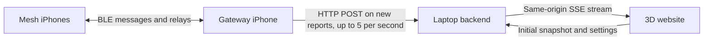

# Local mesh positioning dashboard — implementation plan

## 1. Goal and scope

Build an offline-capable website that receives device positions from an iPhone gateway over local Wi-Fi and visualizes them in an interactive 3D scene.

This file is the complete plan for the website and its integration points. It does not change the iPhone app or implement the positioning solver. The app team should only need to add a server URL, a gateway toggle, and a periodic JSON upload.

**MVP assumptions**

- One laptop runs the backend and serves the website.
- One manually selected iPhone gateway uploads mesh data.
- The laptop and gateway share a Wi-Fi network that permits communication between clients.
- Internet access is not required after installation and building.
- The iPhone app stays in the foreground during the demo.
- Devices or the positioning component already produce coordinates in a shared coordinate frame. Receiving BLE messages alone does not produce positions.

## 2. Connectivity architecture



### Recommended stack

| Component | Choice | Reason |
|---|---|---|
| Gateway upload | Swift URLSession HTTP POST | Built into iOS; no socket library or persistent connection |
| Backend | Node.js LTS, TypeScript, built-in HTTP server | Small API and in-memory state; no database needed |
| Browser updates | Server-Sent Events (SSE), native EventSource | One-way updates, automatic reconnection, simpler than WebSockets |
| 3D scene | Three.js with OrbitControls | Orbit, zoom, picking, labels, and a coordinate grid |
| Frontend build | Vite with locally installed dependencies | Bundle all assets so runtime does not depend on a CDN |
| UI | Plain TypeScript, HTML, CSS | Avoid extra framework setup for this small dashboard |

SSE replaces the previously suggested WebSocket because the website only needs to receive live data. Browser controls can use ordinary HTTP requests. This does not change the app-side upload interface.

Keep the eventual dashboard implementation in its own project area to avoid mixing it with the iPhone and positioning components. This document remains the single planning file.

## 3. Laptop and network setup

1. Prefer a small router or access point controlled by the team. Internet uplink is optional.
2. Connect the laptop and gateway iPhone to it. Avoid venue guest Wi-Fi with client isolation.
3. Start the backend bound to `0.0.0.0`, on configurable port `3000` by default.
4. Allow inbound TCP on that port for the laptop's private network profile.
5. Open `http://localhost:3000` on the laptop to view the dashboard.
6. Enter the laptop's Wi-Fi IPv4 address in the app, for example `http://192.168.1.20:3000`.
7. Test the app's “Check connection” action before enabling uploads.

`localhost` on an iPhone refers to the phone, not the laptop. The app must use the laptop's LAN address. Show the current connection URL prominently on the dashboard and print candidate LAN addresses at server startup. If multiple adapters exist, let the operator choose the Wi-Fi adapter address.

If venue networking fails, switch both devices to the team's own access point. No cloud fallback is required for the MVP.

## 4. Minimal iPhone integration

### UI

- **Server URL:** editable and retained between launches.
- **Check connection:** requests `GET /api/health` and displays the result.
- **Gateway mode:** explicit start/stop switch; do not implement automatic gateway election.
- **Upload status:** last successful upload, pending device count, and last connection error.

### Behavior

- Upload a batch as soon as new reports arrive (at most every 0.2 s), and at least once per second as a heartbeat, while gateway mode is enabled.
- Include the newest known position for each device, preserving its original identity and update sequence when relayed.
- Use one in-flight request at a time with a short timeout, such as three seconds.
- On failure, retain only the latest unsent update per device rather than accumulating every sample.
- Retry with backoff capped at five seconds; coalesce new samples into the pending state.
- Treat any successful 2xx response as delivery acknowledgement. Surface malformed-data errors rather than retrying them indefinitely.
- Other mesh phones do not need Wi-Fi or HTTP upload code.

Use URLSession with `Content-Type: application/json`. Add the iOS local-network usage description. Configure local development HTTP access according to the target iOS version's App Transport Security rules; avoid a blanket production exception. Test permissions and numeric LAN-address access on a physical iPhone early.

This is a foreground demo, not a promise of reliable background BLE relaying or continuous uploads while phones are locked.

## 5. Position contract

### Coordinate convention

- Local Cartesian coordinates, measured in **meters**.
- `x`: right across the demo floor plan.
- `y`: up/height.
- `z`: forward across the floor plan.
- All positions belong to one explicitly named `frameId` with a fixed origin and orientation.
- The gateway forwards coordinates; it does not reinterpret each phone's private coordinate frame.
- Phone-relative UWB directions or distances must be transformed by the positioning component before submission.

Start with one frame, such as `demo-room-v1`. A new origin or axis orientation requires a new frame ID and an explicit dashboard reset. Never silently mix frames.

### Upload example

`POST /api/updates`

```json
{
  "schemaVersion": 1,
  "gatewayId": "phone-gateway",
  "frameId": "demo-room-v1",
  "units": "m",
  "devices": [
    {
      "id": "phone-4",
      "label": "Moving phone",
      "epochId": "8fa55ddd-0a2b-49a5-9c58-8fc90f66a555",
      "sequence": 42,
      "role": "mobile",
      "position": { "x": 2.1, "y": 1.2, "z": 3.4 },
      "positionMode": "3d",
      "accuracyMeters": 1.5,
      "measurementAgeMs": 350,
      "neighbors": [
        { "id": "anchor-north", "rssi": -61, "ageMs": 300 }
      ]
    }
  ]
}
```

### Field semantics

| Field | Meaning |
|---|---|
| `id` | Stable app-level device ID, not a Bluetooth MAC address |
| `label` | Optional short human-readable name |
| `epochId` | UUID generated when a device's originating update stream restarts |
| `sequence` | Increasing safe integer generated by the originating device, not the gateway |
| `role` | `anchor`, `mobile`, or `gateway` |
| `position` | Finite numeric coordinates in the declared frame |
| `positionMode` | `3d` for estimated height; `floor` for an explicitly assumed floor-plane height |
| `accuracyMeters` | Optional 95 % radius around `position`, meters, for every source (each converts at the phone); omit when unknown |
| `measurementAgeMs` | Optional nonnegative elapsed age at upload, only if the mesh can propagate it reliably |
| `neighbors` | Optional list of this phone's current direct BLE neighbors (at most 16): `id` of the peer, optional `rssi` in dBm (-127 to 20), optional `ageMs` since the link last carried a packet. Only direct links the originating phone observed; never relayed paths. Omit when unknown |

An omitted device is not deleted: uploads contain updates, not authoritative membership snapshots. The server assigns receipt times. An unchanged `(id, epochId, sequence)` must not become a fresh position merely because the gateway uploads it again.

For an existing epoch, ignore duplicate or lower sequences. Accept a newly observed epoch as a stream restart and retain previously retired epoch IDs for the demo session so delayed old packets cannot reactivate them. This simple rule assumes one originating app instance per device ID.

Return accepted and ignored counts. Reject invalid batches atomically with a readable error. Check schema version, units, frame, enums, lengths, safe integer sequences, and finite numbers. Apply practical limits, for example 256 KiB per request and 100 device entries per batch.

### Honest positioning fallback

If only floor-plan coordinates exist, use `positionMode: "floor"` and `y: 0`, with an obvious “height assumed” indicator. Do not present that as measured 3D positioning. If only zones, RSSI, or distances exist, show “position unavailable” until the positioning component provides coordinates; do not invent a 3D location.

The optional age field must not be calculated by subtracting unsynchronized phone wall clocks. Without reliable age information, label freshness as “received recently,” not “measured recently.” With age information, uncertainty about transport delay should still be acknowledged.

## 6. Backend behavior

### Endpoints

| Endpoint | Behavior |
|---|---|
| `GET /` | Serve the dashboard and locally bundled assets |
| `GET /api/health` | Return service status and schema version |
| `POST /api/updates` | Validate and merge a gateway batch; return accepted/ignored counts |
| `GET /api/state` | Return the current full scene state |
| `GET /api/events` | Open the browser's SSE stream |
| `POST /api/reset` | Clear the current live frame after explicit operator confirmation |

Keep state in memory for the MVP: devices, frame, gateway upload health, retired epochs, a short position trail, and receipt times. Server restart clears live state; display this limitation. Do not add accounts, a database, or cloud services.

At the expected small demo size, broadcast complete state snapshots rather than implementing incremental synchronization: right after each accepted upload or simulated batch (about 30 ms later, uploads that arrive together pushed once, at most every 100 ms), plus a one-second tick for everything else. Measured on the laptop, an upload reaches browsers in about 50 ms (previously up to a second); the simulators update every 2 s. Each move animates over about the gap since that phone's previous update (0.15 to 2 s), so 5 Hz phones stay snappy and simulated ones glide. Immediately send a full snapshot on every SSE connection, then heartbeat comments about every 15 seconds. Handle disconnected or slow clients without retaining unbounded write queues. The browser uses the latest complete snapshot after reconnecting.

Track gateway connectivity separately from individual position freshness: successful duplicate uploads prove the gateway is connected, not that a device has a new position. Suggested defaults: gateway warning after five seconds without a valid upload; device fade after five seconds without a new position; device stale after 15 seconds. Keep stale devices visible but clearly marked.

Serve API and frontend from the same origin, including during development through a Vite proxy. No broad CORS configuration is needed for the native iPhone client. This is a trusted-LAN demo without authentication or TLS, not an internet-facing service. Keep request limits, data validation, and safe text rendering despite the low-security scope. Never port-forward the main server to the internet.

### Public access (Cloudflare tunnel)

The dashboard can be published on the internet so phones and browsers do not need the laptop's network. Everything still runs on the laptop; a Cloudflare tunnel forwards to a second, protected listener:

- The backend also listens on `127.0.0.1:3001` (`PUBLIC_PORT`, `0` disables it). Loopback only, so nothing on the LAN or internet reaches it except the local `cloudflared` process. The LAN server on port 3000 is unchanged.
- Every request on it needs a secret. Gateway phones send `Authorization: Bearer <gateway token>` and reach only `GET /api/health` and `POST /api/updates` (same validation and merge rules). Browsers sign in with the dashboard key, either by opening `/?key=<key>` (exchanged for an HttpOnly, Secure, SameSite=Lax cookie and stripped from the address bar) or through the login page; after that the whole dashboard, SSE stream and controls work as on the LAN.
- Secrets come from `GATEWAY_TOKEN` / `DASHBOARD_KEY`, or are generated once into the git-ignored `website/.gateway-token` and `website/.dashboard-key`. Delete a file and restart to rotate it.
- `cloudflared` comes from `$CLOUDFLARED`, else `website/.bin/` (filled by `npm run tunnel:install`, which downloads the official release binary without winget or admin rights), else PATH (winget, Scoop, Chocolatey or Homebrew installs).
- `npm run tunnel` runs `cloudflared` over HTTP/2 (TCP 443; `TUNNEL_PROTOCOL=quic` to change) under a watchdog: it checks the public URL every 20 s and restarts the tunnel after three failures in a row, unpublishing the dead URL meanwhile. A restarted quick tunnel gets a new URL, so the gateway phone must rescan its QR code; a named tunnel keeps its hostname.
- It also starts `cloudflared`, registers the public URL with the backend (loopback-only `POST /api/tunnel`, refreshed every 30 s and forgotten after 75 s without a refresh), and prints the dashboard link, the gateway URL and token, and QR codes for both. The dashboard header and Connect panel show the same details (`GET /api/connect`).
- Without setup it uses a quick tunnel (random `https://….trycloudflare.com`, no account, new URL every run). For a fixed address on a domain in your Cloudflare account, run `npm run tunnel:setup -- mesh.example.com` once: it logs `cloudflared` in (browser), creates the `meshmapper` tunnel, routes the hostname to it and writes the git-ignored `website/.tunnel.json`; `npm run tunnel` then uses it.
- The gateway phone's QR code is `meshmapper://gateway?url=<base>&token=<token>`; scanning it with the iPhone camera opens the app with both fields filled in.

## 7. Website layout and interactions

### Header

- Live/simulated badge, with clearly different colors.
- Gateway connection indicator and last valid upload age.
- Browser-to-server connection indicator.
- Active frame and units.
- Laptop LAN upload URL.

### Main 3D viewport

- Meter-scaled floor grid and labeled X/Y/Z axes.
- Different shapes or colors for anchors, gateway, and moving devices.
- Labels, click-to-select, orbit, pan, zoom, fit-all, and top-down view.
- Height stems from the floor to devices so elevation is understandable.
- Optional uncertainty indicators, explicitly described as estimates rather than guaranteed bounds.
- Short bounded trails, visually separate from current positions.
- Gray/faded stale devices and an explicit legend.

### Map view (simulated field site)

A separate "Map" tab (`#map`) shows an offline, top-down 2D map of a simulated GNSS-denied field site, about 800 × 600 m. It runs only in simulated mode and follows the simulation's pause and restart controls; live uploads stay in the 3D scene.

- Infrastructure anchors exist only in this simulation and are not part of the upload contract: cell towers, Wi-Fi access points, a BLE beacon and anchor phones, each with a simulated coverage range.
- Phones walk looping routes. Each shows a simulated accuracy circle derived from the anchors in range ("no fix" when none), dashed fix lines to those anchors, a trail, and BLE links to phones within 50 m.
- Canvas rendering with pan, wheel zoom, fit, a metric grid, scale bar and north arrow; no map tiles or network access. Clicking a marker or a row in the field-site list shows its details.
- The server pushes the field snapshot as the SSE `map` event once per second (`GET /api/map` for the current state). Types live in `shared/map.ts`.

### Position sources in the 3D view

- Every phone label names where its position comes from: "GPS ±8 m", "Bluetooth ±12 m" (placed by the dashboard), "motion + anchors", "UWB", "manual" or "pinned anchor"; the side panel repeats it as Position source.
- A phone reporting `positionSource: "gps"` gets a cyan dashed beam up to a small satellite marker and a thin cyan ground ring of its reported accuracy (instead of the wireframe sphere), so GPS fixes stand out from manual or Bluetooth positions at a glance. When its reports stop (stale), beam and ring turn grey. Display → **GPS signal** toggles them; the legend lists "GPS fix". They are hidden in Signal map layout, whose positions have no place in the world.
- Framing keeps the anchors in view together with the main group of phones; only far outliers are left out.

### Real GPS coordinates and stationary anchors

- In GPS frames, phone labels show real coordinates (latitude, longitude to 6 decimals, about 0.1 m); the side panel keeps both those and frame meters. The anchor editor takes latitude, longitude and height (pre-filled with where the phone is now, so a GPS phone pins at its GPS position) and converts them to frame meters with the frame origin.
- Anchors are stationary. A phone with role `anchor` is always drawn at the position it reports; the signal map does not nudge it. When an anchor loses GPS (it reports `positionSource: "none"`), the server keeps it at its last GPS fix (`lastGps`, kept across epochs) with that fix's accuracy: it is drawn there with a grey GPS beam, labeled "GPS lost · held at last fix" and drawn dimmed with a dashed label ("GPS lost" in the device list), flagged as `gpsHold` in snapshots, and still used as a prior for placing other phones. Pins take precedence over held fixes.
- Signal map layout and Center on anchors exclude each other: turning one on turns the other off.

### The dashboard as a mesh node

The Network page can turn the dashboard into a mesh node: the laptop's own Bluetooth joins the phones' BLE mesh through Web Bluetooth (Chrome or Edge, on a secure page: `http://localhost:3000` on the laptop or the https tunnel), so no gateway phone or network is needed near the laptop.

- **Connect a phone…** opens the browser's picker filtered to the app's service UUID; the user picks each phone once per session. The node is a GATT central: it subscribes, sends its Hello (the app's `MeshProtocol.version`, currently 4; the frame in the panel, a stable `dashboard-…` ID and label "Dashboard (laptop)"), and the link is ready when the phone's Hello matches. It reconnects with backoff when a phone drops.
- Writes are chunked to fit a single ATT write: 180 bytes, falling back to 20 when the phone rejects a longer write (a prepared write).
- Received position packets follow the app's rules (`src/meshproto.ts`, a port of MeshCore's `Framing`, `FrameAssembler`, `LinkOutbox`, `Hello`, `MeshPacket` and `MeshStore` relay rules): newer reports by epoch and sequence are uploaded once a second to `/api/updates` with the node as gateway, and relayed to the node's other phones with one hop fewer and the node on the path (latest per origin per link). The node also uploads its own report (role gateway, no position, its links as neighbors), so it appears in the graph; pin it as an anchor to place it.
- `npm run check:mesh` checks the port against the app's behavior. A wire change in the app (`MeshProtocol.version`) must be made in `src/meshproto.ts` too.

### Compass, coordinates and map background

- Frames with a GPS origin (`shared/geoframe.ts`, a copy of the app's `GeoFrame.origins`; `hervanta-v1` is Tietotalo, Hervanta) have x east and z north (or +z along the origin's bearing). Three.js is right-handed with y up, so the 3D view draws frame +z as scene -z: north points away from the default camera and up in Top down. Drawing it as +z would mirror the site.
- Axes are labeled E / Up / N in north-up GPS frames (X / Z otherwise). Each phone label has a second line with its frame coordinates, e.g. "12.3 m E · 4.5 m N" (negative values as W / S), always in real frame coordinates even when Center on anchors shifts the drawing; the side panel adds latitude and longitude. Signal map layout hides coordinates and compass, since its positions have no place in the world.
- **Map background (OpenStreetMap)** (Display, off by default) lays OpenStreetMap tiles on the floor under the stage, placed from the frame's GPS origin and rotated by its bearing, at a zoom where about four tiles span the stage (at most 64 tiles, re-requested only when the stage moves). It needs internet; the attribution "© OpenStreetMap contributors" is shown on the view while it is on, and failed tiles are reported. Google map tiles are not used: their terms forbid direct tile access.

### Anchors and framing

- The operator can pin any phone as an anchor from the selected-device panel: enter where it really is (meters) and choose **Make anchor**. The server keeps pins per scene (`POST /api/anchors` with `{ id, pin: {x, y, z} | null }`; reset clears them). A pinned phone is shown and used as an anchor at the pin; `reported` keeps what the phone itself sent, and **Remove anchor** returns to it. Phones are not told; this changes the dashboard only.
- Pins are anchors for the server's Bluetooth placement: phones without their own position are placed from their links to pins and to phones that report a position. A pinned phone is never placed by the estimator.
- **Center on anchors** (Display, on by default) draws the scene shifted so the anchors' midpoint sits at the axes and the stage, like the signal map layout does for its groups. It is display only: panels and pages keep frame coordinates, and a note shows the offset. Live-data pins are saved in the git-ignored `website/.anchors.json` (`PINS_FILE` overrides it) and survive restarts; clearing the live scene removes them. Pinning or unpinning restarts that phone's trail.
- The 3D view centers on the anchors, or without anchors on the main group of phones (phones beyond 4× the group's median spread are left out of the framing). The floor grid moves under that content and grows with it; the axes stay at the frame origin. It keeps re-centering when content moves noticeably, until the user orbits or zooms; **Fit all** or **Reset camera** turns auto-centering back on, and changing anchors always re-centers. Fog and the far plane scale with the viewing distance.
- A gateway health check with the token records `gateway.lastCheckAt`. When the phone checked in recently but nothing was uploaded, the header and Gateway page say "connected, not uploading" and point at the app's **Upload as gateway** switch.

### App-style pages

Next to the 3D scene and the map, header tabs open full-page views that mirror the iPhone app's tabs, built from the same scene snapshots:

- **Network:** data mode, device count with stale devices, current BLE links and gateway health; a device table (role, link count, last report, sequence, epoch); a link table (pair, signal, reported by one or both ends, age), using the same expiry as the 3D view; and diagnostics (batches, accepted, ignored as duplicate or old, rejected).
- **Positions:** every device's reported x/y/z, whether height is estimated or assumed, accuracy, measurement age, receipt age and trail length, with the frame and axis convention. Values are shown as reported, never as measurements.
- **Gateway:** gateway phone, last upload and whether uploads are accepted in the current mode; public and LAN upload addresses; upload counts; and a large QR code with the steps to connect the gateway phone.

Rows on the Network and Positions pages open that device in the 3D scene. Tables update rows in place so one-second refreshes do not swallow clicks.

### Side panel

- Device list with role, coordinates, freshness, and available accuracy.
- Selected-device details and follow-device camera toggle.
- Display toggles for labels, trails, uncertainty, and grid.
- Demo controls: start/pause simulation, reset camera, and confirmed live-state reset.

The 3D view is a graph of phones. Anchor phones (fixed, known coordinates) define the frame: they get a halo, the floor area they span is outlined, and top-down view centers on them. Edges are drawn only from the optional `neighbors` observations (`src/graph.ts`). Each pair is drawn once and expires 10 seconds after the freshest report from either end (receipt time plus `ageMs`). Phones report at different times, so the two ends are reconciled:

- A link both ends report is **confirmed**. One reported by one end only is **one-sided** and drawn dashed.
- A one-sided link is dropped when the other end's report is more than 3 s newer, still current, and lists other neighbors but not this one: the link has closed. An empty or full (16) list is not evidence.
- Link RSSI is the mean of both directions, which cancels most per-phone transmit/receive gain differences. A difference of 6 dB or more is shown as asymmetric in the details panel. Line brightness follows RSSI.

Do not infer radio links from proximity or from gateway receipt. A relayed position is not evidence of a direct BLE connection.

### Signal map

The server runs `shared/signalmap.ts` once a second over fresh devices (the phones run the same solver, MeshCore `SignalMap`; see app.md, "Signal map"). It lays phones out so distances match their Bluetooth ranges, with reported positions as priors, and calibrates the radio from links between phones placed to within 3 m.

- A phone with `positionSource: "none"` is drawn at its signal-map spot (`estimate`), or not at all while its group has no placed phone.
- A phone with a position and Bluetooth links is drawn at its signal-map spot, so distances on the map equal the measured ranges; its report is kept in `reportedPosition` (shown in the details panel and on the Positions page).
- A phone known only by distance (one link, or a group whose rotation no placed phones fix) gets `estimate.ambiguous` and ring points around the ring's centre; it is drawn at its best-guess spot, never at the centre.
- The Display panel's **Signal map layout** shows every connected group by its ranges alone, side by side; orientation is meaningful only for groups anchored in the world. The details panel lists each link's measured range next to its distance on the map, and the panel shows the calibrated radio.

### Rendering rules

- Render independently of the upload rate; target smooth interaction on a normal laptop.
- Interpolate display motion between accepted samples over a short interval; preserve raw values in the details panel.
- Do not extrapolate indefinitely when updates stop.
- Cap trail history and dispose of removed Three.js objects.
- Show an empty-state explanation before the first position arrives.

## 8. Simulation and team integration

Build the dashboard against simulated data before waiting for the Bluetooth app.

- Generate three fixed anchors and two moving devices with known height changes.
- Use the same validation and state-merging path as real uploads.
- Include controls to simulate a stale device and disconnected gateway.
- Keep simulation explicitly separate from live state. Switching modes clears the scene after confirmation; never silently replace missing live devices with fake positions.
- Provide an example JSON batch and a repeatable laptop-side upload check using the contract above.

### Ownership boundaries

| Part | Responsibility |
|---|---|
| Mesh app | Discovery, BLE links, relay behavior, origin IDs and sequences |
| Positioning component | Shared coordinate frame, estimated coordinates, optional uncertainty and reliable age |
| Gateway integration | Gather latest mesh positions, batch HTTP uploads, connection UI |
| Website/backend | Input validation, deduplication, freshness, SSE distribution, visualization |

## 9. Delivery order

1. **Contract and network spike:** agree on axes and fields; make a physical iPhone successfully call laptop health and upload one fixed position.
2. **Backend slice:** implement validation, in-memory merge, health, state snapshot, and SSE.
3. **3D slice:** render anchors and devices from snapshots with orbit, selection, labels, and fit-all.
4. **Simulation:** exercise motion, height, duplicates, reconnects, and stale-data UI without the mesh.
5. **Gateway integration:** replace simulated batches with real mesh positions; preserve origin sequences through relays.
6. **Demo polish:** add trails, uncertainty display, clear status indicators, and the operator connection instructions.

Prioritize working uploads and an honest position display over automatic discovery, routing visualizations, recording/replay, or elaborate scene assets.

## 10. Acceptance checks

- With internet disconnected but local Wi-Fi active, the gateway uploads and the laptop displays the scene; browser reload still loads every required asset.
- At a one-second upload interval, accepted updates normally appear within roughly two seconds of gateway upload, excluding upstream mesh/solver delay.
- A known `(x, y, z)` point appears on the correct axes and scale; a test height change visibly moves it vertically.
- Floor-only positions are labeled as assumed height, not measured elevation.
- Repeated or out-of-order sequences neither move a device backward nor refresh its position freshness.
- A new epoch allows a sequence restart; delayed packets from a retired epoch are ignored.
- A frame mismatch is rejected with an actionable message instead of mixing coordinate systems.
- Browser reconnection receives a full snapshot without requiring an app restart.
- Gateway disconnection and stale devices produce distinct visible states.
- Invalid JSON, oversized requests, unknown schemas, and invalid coordinates return controlled errors; the server remains responsive.
- Live and simulated data cannot be confused or silently mixed.
- Trails and disconnected browser clients do not cause unbounded memory growth.

**MVP outcome:** a local laptop dashboard showing real mesh-reported positions, with a minimal HTTP-only gateway addition to the iPhone app and no internet dependency during the demo.
