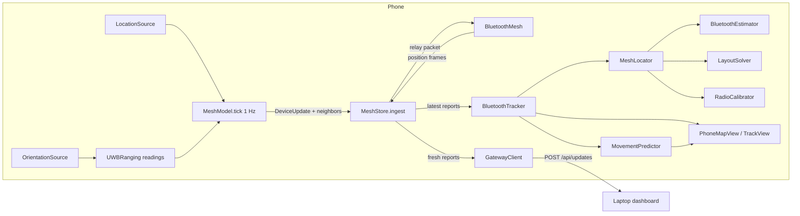

> **Historical:** describes the unmerged branch `feature/map-accuracy` at `87b2f6c`, not `main`. Its phone-to-phone UWB distances were ported to `main` as wire v5 (`feature/uwb-v5`); `MeshLocator`, `LayoutSolver`, hand-held UWB bearings and the map UI described here are not on `main`. See [docs/AUDIT.md](../../AUDIT.md).

# MeshMapper iOS app: technical report

Scope: the iOS code on branch `feature/map-accuracy` at commit `87b2f6c` ("Fix integration review findings for map accuracy"). All paths are relative to the repository root. This report describes the code as it is, not as planned. Where the plan documents (`app.md`, `features.md`, `DEMO.md`) and the code differ, the code is described and the difference is noted.

## 1. Summary

MeshMapper is a native iPhone app (Swift, SwiftUI, iOS 17+) for locating people when GNSS is unavailable or poor. It has four parts:

- **BLE mesh.** Phones that have the app in the foreground link to each other over Bluetooth LE GATT and relay each phone's once-per-second position report hop by hop. This is an application-level relay, not Bluetooth SIG Mesh.
- **UWB ranging.** On iPhone 11 and later (not SE), linked phones run Nearby Interaction sessions. Each phone adds its measured UWB distance, and on some models a bearing, to the neighbour list in its own report.
- **On-phone positioning.** Every phone places all phones it hears about, including phones that have no position. It runs a particle filter (RSSI and UWB) and a joint least-squares layout solver (UWB, RSSI, GPS and bearings), then draws the result on a MapKit map. No network is needed.
- **Gateway.** One phone, chosen by hand, uploads the latest reports over HTTP to the laptop dashboard (`website/`), on the LAN or through a Cloudflare tunnel.

**Status.** According to `features.md`, every map-accuracy feature on this branch is "Built, untested". Nobody on the team had a Mac while this work was written, so on this branch the Swift code has not been compiled, `swift test` has not been run, and nothing has been installed on a phone. Every statement about behaviour in this report comes from reading the code and the unit tests. None of it is measured.

## 2. Architecture

### 2.1 Components

| Layer | Location | Contents |
|---|---|---|
| MeshCore (Swift package, no Apple radio frameworks) | `ios/MeshCore/Sources/MeshCore/` | Wire models and validation (`Models.swift`), framing and outbox (`Framing.swift`), dedup store (`MeshStore.swift`), RSSI smoothing (`RSSIStatistics.swift`), ranging messages and geometry (`Ranging.swift`), UWB session policy (`UWBSessionPolicy.swift`), particle filter (`BluetoothEstimator.swift`), layout solver (`LayoutSolver.swift`), orchestration (`MeshLocator.swift`), RSSI calibration (`RadioCalibrator.swift`), map display rules (`MapPresentation.swift`) |
| App target | `ios/MeshMapper/` | Core Bluetooth (`BluetoothMesh.swift`), Nearby Interaction (`UWBRanging.swift`), Core Motion (`OrientationSource.swift`), Core Location (`LocationSource.swift`), HTTP upload (`GatewayClient.swift`), orchestration (`MeshModel.swift`), tracker adapter (`BluetoothTracker.swift`), movement prediction (`MovementPredictor.swift`, `MovementModel.swift`, `movement-model.json`), UI (`PhoneMapView.swift`, `TrackView.swift`, `ContentView.swift`) |
| Project | `ios/project.yml` | XcodeGen spec. Bundle `com.hackathonmapper.MeshMapper`, iOS 17.0, Swift 5.9, iPhone only, build number 7 |

The design rule (CLAUDE.md) is that all testable logic lives in MeshCore and the app target only adapts framework callbacks and draws. The branch mostly follows it. The exceptions are the UWB session lifecycle (`UWBRanging`), the BLE link state machine (`BluetoothMesh`) and the gateway retry loop (`GatewayClient`), which have no unit tests.

### 2.2 Data flow

Once per second, `MeshModel.tick()` (`ios/MeshMapper/MeshModel.swift`) does the following in order:

1. Publishes this phone's report (`publishCurrent`).
2. Reconciles UWB sessions.
3. Queues fresh reports for the gateway.
4. Runs the tracker over all stored reports.
5. Runs the movement predictor.
6. Every 5 s, rebroadcasts the cached relay packets (`sync`).

### 2.3 Threading

Everything runs on the main queue. `CBCentralManager` and `CBPeripheralManager` are created with `queue: .main`, `NISession.delegateQueue = .main`, Core Motion delivers to `.main`, and `MeshModel`, `GatewayClient`, `BluetoothTracker` and `MovementPredictor` are `@MainActor`. `MeshStore` enforces this with `precondition(Thread.isMainThread)`. This removes data races, but the positioning math runs on the UI thread. That math is a 600-particle filter plus dense Levenberg-Marquardt (LM) with an O((2N)³) Cholesky factorisation. `testFifteenPhonesUpdateQuickly` measures one update for 15 phones with XCTest `measure`, but it sets no time limit, and the run time has not been recorded on a device.

### 2.4 Key types

| Type | File | Role |
|---|---|---|
| `DeviceUpdate`, `NeighborObservation`, `Position`, `PositionSource` | `Models.swift` | One phone's report. Matches the dashboard upload entry |
| `MeshPacket`, `Hello` | `Models.swift` | Relay envelope; link handshake |
| `Frame`, `FrameAssembler`, `LinkOutbox` | `Framing.swift` | Link framing, reassembly, per-link coalescing queue |
| `RangingToken`, `RangingFix`, `AnchorGeometry`, `PeerBearing`, `LinkBearing`, `RotationMatrix` | `Ranging.swift` | UWB messages and geometry |
| `LinkMeasurement`, `EstimatorAnchor`, `RadioModel`, `FloorPoint` | `BluetoothEstimator.swift` | Positioning inputs |
| `PhoneFix`, `PositionBasis`, `EstimateRing` | `MeshLocator.swift` | Positioning output |
| `TrackedPhone`, `TrackedLink` | `BluetoothTracker.swift` | Values the UI draws |

## 3. Bluetooth mesh

### 3.1 GATT roles and link setup

Each phone is both peripheral and central (`BluetoothMesh.swift`). It advertises service `F7A40001-5AB1-4E90-A989-21B5E52E2210`, which has one characteristic `F7A40002-…` with `.write` and `.notify`, and it scans for the same service with duplicates allowed. A link is identified by `LinkID.outgoing(peripheralUUID)` (this phone is the central) or `.incoming(centralUUID)`. It goes through the states `connecting → linking → ready`:

1. As central: connect, discover the service and characteristic, then enable notifications. As peripheral: the remote central subscribes.
2. Each side sends a `Hello {protocolVersion, frameId, deviceId, label?}` as its first frame.
3. A link is `ready` only when it is subscribed and a valid Hello has arrived. If the version or frame is different, or the Hello carries this phone's own ID, the link is rejected. An outgoing link is closed and retried after 60 s. An incoming link is marked `rejected`, and later writes on it fail with `.unlikelyError`, because a peripheral cannot disconnect a central.
4. Duplicate links: if two phones link in both directions, the phone with the higher device ID closes its outgoing link (`reconcileLinks`), so the link started by the lower ID survives. Sending uses `preferredLink`, which picks the canonical direction.
5. Limits: at most 8 logical neighbours (`maxNeighbors`). Link setup must finish within 10 s. After a failure the central backs off 5, 10, 20, 40, then 60 s, plus 0–2 s of jitter. A link that stays ready for 30 s resets the backoff. A peer that has not been heard for 30 s is forgotten.

Mesh identity comes only from the Hello. Core Bluetooth UUIDs are used only as transport handles.

### 3.2 Framing and chunking

`Framing.encode` writes `[type: UInt8][length: UInt32 BE][payload]`, with payloads of 1–4096 bytes. `FrameAssembler` accepts arbitrary chunk boundaries. It buffers at most 8 KiB and drops a partial frame after 10 s. A type-0 header, an invalid length or a buffer overflow throws an error and resets the assembler. Unknown non-zero frame types are skipped. Central-to-peripheral chunks are sized to `maximumWriteValueLength(for: .withoutResponse)` but are sent `.withResponse`, one at a time (`writing` set), so each chunk fits a single ATT write. Peripheral-to-central chunks are sized to `maximumUpdateValueLength`. When `updateValue` returns false, draining stops and resumes in `peripheralManagerIsReady`.

### 3.3 LinkOutbox coalescing

Each link has one `LinkOutbox`. It holds at most one pending frame per key. Position frames use the key `position:<originId>`, and a newer report for the same origin replaces the queued one but keeps its place in the queue. The frame that is currently being chunked is never interrupted. Hello, ranging tokens and ranging fixes use the fixed keys `hello`, `rangingToken` and `rangingFix`.

### 3.4 Relay rules

`MeshStore.ingest` (`MeshStore.swift`) applies these rules:

- It validates the packet, requires a matching `frameId`, and drops any copy whose `path` already contains this phone.
- Per origin it keeps the latest `(epochId, sequence)`. In the same epoch, only a higher sequence is accepted. A new epoch is accepted once, and earlier epochs stay retired for the session (at most 100 epochs per device and 100 devices).
- A relay keeps `id`, `epochId` and `sequence`. It decrements `hopsRemaining`, appends its own ID to `path`, and stops relaying at 0 hops or when the path is full (8).
- The origin publishes with `originHops = 5`. Ingesting its own packet uses one hop, so direct neighbours receive 4 (`MeshModel.swift`).

`MeshModel.accept` forwards a relay to every ready neighbour except the one it came from. Before sending it waits a random 0–100 ms, and a newer relay of the same origin replaces one that is still waiting (`BluetoothMesh.relay`). Every 5 s, cached relay packets that are fresh (≤ 30 s, `staleAfter`) are rebroadcast without refreshing hops or path, and a newly ready neighbour gets them at once (`sync(to:)`). Reports that loop back to their origin are counted as duplicates.

### 3.5 Wire format, version 4

`MeshProtocol.version = 4` (`Models.swift`). The `Hello` and `MeshPacket.schemaVersion` both carry the version, and a mismatch is refused. Version 4 is a bump even though the new fields are optional, because relays re-encode the packets they decode, and a version 3 relay would silently drop the new fields.

| Frame type | Payload (JSON) | Scope | Limits |
|---|---|---|---|
| 1 Hello | `protocolVersion, frameId, deviceId, label?` | link | ≤ 512 B |
| 2 Position | `MeshPacket {schemaVersion, frameId, hopsRemaining, path[], update}` | relayed | ≤ 4096 B; hops 0…8; path ≤ 8 unique IDs |
| 3 Ranging token | `{token, isAnchor, uwbDirection}` | link | token 1–1024 B; `uwbDirection` absent means false |
| 4 Ranging fix | `{anchorId, targetId, position, accuracyMeters, distanceMeters}` | link | coordinates ±10 000 m |

`DeviceUpdate` fields: `id` (≤ 64 UTF-16 units, trimmed), `label?` (≤ 40), `epochId` (UUID), `sequence` (0…2⁵³−1), `role` (`anchor|mobile|gateway`), `position {x,y,z}` (finite, ±10 000 m), `positionMode` (`3d|floor`; `floor` requires `y = 0`), `accuracyMeters?` (0…1000), `neighbors?`, `positionSource?` (`gps|manual|none|uwb`; absent means `manual`).

`NeighborObservation` fields (at most 16, unique, never the reporter):

| Field | Type / range | Meaning |
|---|---|---|
| `id` | string ≤ 64 | Neighbour device ID from the Hello |
| `rssi` | int −127…20 | Smoothed connection RSSI if this phone is the central, otherwise advertisement RSSI |
| `ageMs` | 0…86 400 000 | Time since the link was last heard |
| `uwbDistanceM` | 0…200, rounded 0.01 m | This phone's fresh (≤ 2 s) UWB distance |
| `uwbBearingDeg` | [0, 360), rounded 1° | Map bearing from reporter to neighbour, 0 = +z/north. Requires a distance |
| `uwbBearingErrorDeg` | 1…180, rounded 1° | Requires a bearing |

`testFullNeighborListWithUWBFitsOnePacket` checks that a report at the maximum size still fits in 4096 bytes.

## 4. Ranging and direction

### 4.1 Sessions and token exchange

`UWBRanging.swift` runs one `NISession` per selected neighbour. The two phones exchange archived `NIDiscoveryToken`s in ranging-token frames over the BLE link, and each phone runs `NINearbyPeerConfiguration` with the peer's token. Lifecycle:

- Token resend: every 5 s while a session measures nothing.
- Progress timeout: after 20 s without progress, the session closes and the peer is skipped for 60 s.
- Reopen after an invalidation: 30 s.
- `userDidNotAllow`: all sessions close and ranging stays off until the app restarts. The mesh carries on with RSSI.
- `activeSessionsLimitExceeded`: the budget shrinks.

A distance updates `readings` on every callback. A bearing that drops out (the peer left the field of view) is kept for at most 1 s.

### 4.2 Session policy and budget

`UWBSessionPolicy.select` (MeshCore) ranks candidates by class, then by RSSI, then by ID. The classes are, in order: a link to a direction anchor; a link where either end reports `positionSource == none`; everything else. The budget starts at 4, and after `activeSessionsLimitExceeded` it becomes `max(1, active − 1)` for the rest of the run. A session that has measured for less than 20 s keeps its slot against newcomers of the same or a lower class. `MeshModel.rangingCandidates` builds the candidates from ready neighbours, using the mean of both ends' RSSI where available. It leaves out peers in cooldown and never pairs two direction anchors. An incoming token is accepted only from a selected peer. The policy depends on both ends ranking each other similarly, and nothing guarantees that they do.

Peer ranging is on by default if `supportsPreciseDistanceMeasurement` is true, and the setting is saved in `UserDefaults` under `uwbRanging`.

### 4.3 Anchor fixes (`AnchorGeometry`)

A phone with role `anchor` that reports `supportsDirectionMeasurement` can send fixes to targets. "Use anchor fixes" (`uwbEnabled`) must be on. It is off at every launch, and it is turned off when the role changes. `AnchorGeometry.mapDirection` takes three inputs: the device-frame direction, gravity (which corrects pitch and roll, with a maximum tilt of 60°) and a heading the user types in (the direction the back of the phone faces, measured from +z towards +x). From these it computes a map vector. The fix is the anchor's manual coordinates plus distance × that vector, with accuracy `distance·sin(15°) + 0.3 m`. It is rate-limited to 2 per second per target. A target publishes the freshest, most accurate fix (≤ 3 s old) as `positionSource: "uwb"`. Without one it falls back to the manual pin, GPS or `none` (`publishCurrent`).

### 4.4 Peer bearings (`OrientationSource` + `PeerBearing`)

`OrientationSource` runs Core Motion at 10 Hz in `.xTrueNorthZVertical`, or `.xArbitraryCorrectedZVertical` when true north is not available, in which case only gravity is used. It maps magnetometer calibration to a compass error: high 10°, medium 20°, low 35°, and uncalibrated gives no attitude and no bearing. `PeerBearing.bearing` treats `CMAttitude.rotationMatrix` as reference-to-device, rotates the device direction into the north/west/up frame, converts it to map x = east, z = north, and drops the result if its horizontal component is below 0.3. The bearing error is √(15² + compass²), which comes to about 18°, 25° or 38°. `Ranging.swift` says plainly that this matrix convention has not been checked on a phone, and if it is wrong, every bearing comes out mirrored.

### 4.5 Device support

These are the capabilities the project documents assume. The code checks `NISession.deviceCapabilities` at run time, not the phone model.

| Phone | UWB distance | UWB direction | Possible roles |
|---|---|---|---|
| iPhone SE (all) | no | no | RSSI only |
| iPhone 11–13 | yes | yes, inside the field of view | Peer ranging with bearings; direction anchor |
| Newer iPhones reporting no direction (documented as U2) | yes | no (ARKit camera assistance not implemented) | Peer ranging, distance only |

## 5. Positioning

### 5.1 Inputs

`BluetoothEstimator.input` (`BluetoothEstimator.swift`) uses reports that are fresh (≤ 15 s, `BluetoothTracker.reportMaxAge`). A report with source `gps`, `manual` or `uwb` becomes an `EstimatorAnchor`, and a `none` report becomes a lost phone. For each pair of phones it takes the mean RSSI and the mean UWB distance from both ends' reports, counting only links with report age plus `ageMs` ≤ 6 s, and it keeps the bearing with the lower error, oriented a→b. Anchor σ: GPS max(2 m, accuracy, default 5 m); manual or UWB fix max(0.3 m, accuracy).

### 5.2 RSSI radio model and particle filter

`RadioModel.outdoors` is the log-distance model: p0 = −59 dBm at 1 m, n = 2.5, σ = 5 dB, a hearing range of 60 m with an 8 m logistic fade. This is a port of `website/server/estimator.ts` with UWB extensions. Each phone holds 600 particles, and the PRNG is seeded (mulberry32), so test runs are repeatable. Per second it:

- Spreads lost phones by 0.8 m/s, or 0.4 m/s if the phone has a UWB link.
- Places a cold-start phone on a ring around its best neighbour (UWB first, then the fewest hops) and keeps re-seeding 3 % of particles for 15 s.
- Weights particles by RSSI (Gaussian in dB, tempered by 0.15) or, on UWB links, by a Gaussian in distance. The UWB σ is √(σ_uwb² + 0.5²), each step averages over 24 neighbour particles, tempering is 0.6, there is a likelihood floor of 0.01, and a bearing term is added when a bearing exists.
- Applies a silence penalty to phones it cannot hear, but only if both sides have fewer than 6 links.
- Resamples when the effective sample size falls below N/2.

An estimate is `ambiguous` when r95 > 3 m and less than 5 % of the weight lies within 0.25·r95 of the mean. An ambiguous estimate carries an `EstimateRing` around its best neighbour, with the measured radius.

### 5.3 RadioCalibrator

`RadioCalibrator.swift` fits only p0. From each link that has both RSSI and UWB (distance ≥ 0.5 m), it computes the p0 that would explain that reading, keeps the last 120 samples, and uses their median once there are 10 or more, clamped to −75…−45 dBm. The exponent n stays fixed. Samples are added once per second per link, so 120 samples can be two minutes of one strongly correlated pair.

### 5.4 LayoutSolver

`LayoutSolver.swift` is a Levenberg-Marquardt solver over 2 unknowns per phone (x, z). It solves the dense normal equations with Cholesky, runs at most 30 iterations, and has λ start at 1e‑3, multiplied by 0.3 after an accepted step and by 10 after a rejected one. It also adds a second-order "stretch" term for ranges that are too long, and a 1e‑4 regulariser. All residual terms are normalised by their σ:

| Term | σ | Loss |
|---|---|---|
| UWB range | 0.15 m + 0.02·d | Huber, k = 1.345 |
| RSSI range | `radio.sigma` (dB), log-distance | Huber |
| Bearing | reported error (≥ 1°) | Huber |
| GPS prior | max(2 m, accuracy) | quadratic |
| Manual / UWB-fix prior | max(0.3 m, accuracy) | quadratic |
| Temporal prior (previous solution) | √(σ_prev² + (1.4 m/s · dt)²) | quadratic |

The marginal σ is the larger axis of each phone's 2×2 block of (JᵀWJ)⁻¹. `relativeSigma(a, b)` gives the uncertainty of the vector between two phones. The covariance uses only JᵀWJ evaluated at the solution, so it does not account for Huber down-weighting of outliers. It is an approximation.

### 5.5 MeshLocator orchestration

`MeshLocator.update` (`MeshLocator.swift`):

1. Adds the measurements to the calibrator and gives the filter the calibrated radio model.
2. Runs the particle filter if any phone has no position.
3. Splits the phones into connected components and computes hop counts from placed phones.
4. For each component that has **at least one UWB link and at least one placed phone**, runs `LayoutSolver`. Start points come from the previous solution (if it is at most 5 updates old), else from the report, else from a seed placed at the measured distance from an already-seeded neighbour, pointing towards the filter's estimate, or along a golden-angle spiral if there is no estimate. On a pair that has a UWB distance, the RSSI is not used.
5. Afterwards:
   - A manual or UWB-fix phone is moved by at most its σ (0.3 m by default).
   - A GPS phone with a UWB link of its own becomes `gpsRefined`.
   - A GPS phone without one stays at its report.
   - A phone without a position becomes `uwbRanged`, or `bluetooth` if it has no UWB link of its own. It is marked direction-unresolved when `relativeSigma` to its nearest neighbour (UWB links first) exceeds max(3 m, ½ of that link's length), or when the filter calls it ambiguous and it has no bearing. An unresolved phone is placed on the ring, at the measured radius from its neighbour's drawn point.
6. Phones in components without UWB keep the particle-filter estimate (`bluetooth`). Placed phones stay at their report.

### 5.6 Bases and honesty rules

`PositionBasis` has the cases `reported(source)`, `gpsRefined`, `uwbRanged` and `bluetooth`. `MapPresentation.statusTitle` turns them into "GPS", "Pinned spot", "UWB anchor fix", "GPS + UWB", "UWB-ranged" and "Bluetooth estimate", and adds "· direction unknown" for ambiguous phones. No string in the app calls a solved position "measured"; a test (`testStatusTitlesAreHonest`) covers the titles. The Position tab labels manual coordinates as "Manual / demo coordinates … not measured positions".

### 5.7 Sources this phone publishes

`publishCurrent` publishes, in order of preference:

1. A fresh anchor fix (`uwb`), if anchor fixes are on and the role is not anchor.
2. A manual pin (`manual`), set from the Position tab or by tapping the map with "Pin me" (`pinHere`, accuracy 5 m).
3. GPS (`gps`), if `horizontalAccuracy` ≤ 30 m and the fix is ≤ 30 s old, converted with `GeoFrame` (origin `hervanta-v1` = 61.4499 N, 23.8560 E, equirectangular, ±10 km).
4. Otherwise a placeholder (0, 0, 0) with `none`.

"Simulate losing GPS" removes option 3. The phone's own UWB-ranged or Bluetooth estimate is never published as its position.

### 5.8 Movement model and predictor

`MovementPredictor.swift` keeps each phone's track for 120 s. When the tracker shows a phone as `lastSeen` for at least 5 s, it calls `MovementModel` (Foundation only, no Core ML). The model is a small MLP loaded from `movement-model.json` (version 1, K = 6 Gaussian mixture components, 31 history points spaced 2 s apart, horizon 2–180 s, SiLU activations). It returns a mixture. From the mixture the predictor draws 80 seeded samples and takes their 95 % radius, which the map draws as a single circle centred on the weighted mean. According to the file header, the model was trained on walking tracks around Hervanta. There is no accuracy evaluation of it in this repository's iOS code.

## 6. Map and UI

`ContentView` shows `PhoneMapView` full screen. A settings sheet holds the tabs Track, Start, Network, Position and Gateway (`ContentView.swift`).

### 6.1 PhoneMapView rendering rules

`PhoneMapView.swift` uses MapKit with points of interest hidden and frame coordinates converted through `GeoFrame.coordinate`.

- **Markers.** The colour shows the basis: GPS violet, GPS + UWB blue, UWB-ranged or UWB anchor fix green, Bluetooth cyan, predicted orange, unplaced grey. This phone's marker is larger (22 pt against 16 pt). Each marker has a circle of the phone's radius, and last-seen markers are dashed.
- **Rings.** A direction-unresolved phone gets no dot. Instead the map draws a dashed `MapCircle` of the measured radius around its neighbour, with the caption "Otter 42 · 4.1 m · direction unknown" (`MapPresentation.ringCaption`). If no ring is available, it uses the phone's 95 % circle.
- **Links.** A link with a UWB distance is drawn solid (2.5 pt) and labelled "3.42 m". An RSSI-only link is dashed (1.5 pt) and labelled "≈ 4 m", in whole metres, never "0 m". Labels are shown on this phone's links; any other link shows its label when tapped. A link turns amber when the drawn length differs from the measured distance by more than max(1 m, 30 %). Links to a phone drawn as a ring are not drawn.
- **Prediction.** Once the predictor takes over, the marker moves to the prediction centre and its circle is the prediction's 95 % radius. Particle and prediction dots appear only with "Particles (debug)" turned on.
- **Status card.** Shows the basis title, the ± radius, the neighbour the phone is placed via, and the hop count.

### 6.2 Camera

The camera centres on this phone. Its span is max(25 m, 2.5 × the farthest direct neighbour), capped at 20 km. It refits only when the needed span changes by more than 30 %, when this phone moves more than 25 % of the span, when a new phone appears, or when the user taps the scope button. Dragging the map stops following. Heading-up mode sets `MapCamera.heading` from `OrientationSource.heading` in steps of more than 4°. Before any phone is shown, the map starts over the frame origin with a 600 m view.

### 6.3 TrackView

`TrackView.swift` works without map tiles. It draws a north-up `Canvas` radar with automatic ring steps (1 m to 5 km), solid UWB links and dashed RSSI links, rings for unresolved phones, trails (120 points), particle clouds and circles. Below the radar is a list of phones with their distance and compass direction from this phone, or "direction unknown" or "direction unclear". The "Distance to linked phones" list reads "3.42 m UWB · −61 dBm", or "≈ d (near–far) · dBm" from RSSI ± 1σ. The radar uses a different colour scheme from the map: green for placed, orange for estimated, grey otherwise.

### 6.4 Settings

| Setting | Where | Persisted | Default |
|---|---|---|---|
| Label, frame ID, mesh running, keep awake | Start / Network | yes | friendly name ("Otter 42"), `hervanta-v1`, on, on |
| Role, source (GPS / fixed spot), manual x/y/z, height mode, accuracy | Position | role, source, x/y/z only | mobile, GPS |
| UWB ranging | Position | yes | on if the phone supports UWB distance |
| Use anchor fixes, anchor heading | Position | heading only | off |
| Simulate losing GPS | Map button, Track, Start | yes | off |
| Server URL, gateway token, upload as gateway | Gateway / Start | yes | `http://192.168.1.20:3000`, empty, off |
| Heading up, legend, particles | Map menu | no (view state) | off |

The Network tab shows linked neighbours with link and advertisement RSSI, the reported direct links with any UWB distance and bearing, the known devices with their relay route, and counters for received, accepted, relayed, duplicate and rejected packets.

## 7. Gateway and dashboard integration

`GatewayClient.swift` keeps a pending map with the latest `DeviceUpdate` per origin, capped at 100. A single worker task sends one request at a time:

- It validates every entry, then POSTs `{schemaVersion: 1, gatewayId, frameId, units: "m", devices}` to `<base>/api/updates` with a 3 s timeout. It adds `Authorization: Bearer <token>` when a token is set.
- On 2xx it removes only the entries that are still identical to what was sent, and adds the accepted and ignored counts.
- On 401 it stops uploading with a readable message.
- On any other 4xx except 408 and 429 (including the dashboard's 400 validation errors and 409 frame or simulated-mode conflicts), it does not resend that exact body.
- On network errors and 5xx it doubles the delay up to 5 s. This backoff has no jitter, although `app.md` asks for it.

`GET /api/health` reports reachability and whether the dashboard is in simulated mode. A `meshmapper://gateway?url=…&token=…` link (from the QR code) fills in the URL and token, opens the Gateway tab and checks the connection, but does not start uploading. Every tick re-enqueues fresh reports with unchanged identities, which acts as a heartbeat. `MeshModel.setGateway` refuses a `*.trycloudflare.com` URL that has no token.

**What the dashboard ignores.** `parseNeighbors` in `website/server/validate.ts` keeps only `id`, `rssi` and `ageMs` and does not reject unknown keys, so the UWB fields are accepted and dropped. `positionSource` is validated and used. The dashboard's estimator therefore still places `none` phones from RSSI only, and the dashboard and the phones can show different positions for the same phone. The dashboard's default frame is `demo-room-v1` and the app's is `hervanta-v1`. The first frame uploaded becomes the dashboard's frame, and a different frame later gets a 409.

The batch is not split by size. Each packet is at most 4 KiB, so 100 devices at the maximum report size could in theory exceed the dashboard's 256 KiB body limit. Normal reports are far smaller.

## 8. Testing

MeshCore has 101 XCTest cases in 6 files (`ios/MeshCore/Tests/MeshCoreTests/`). None has been run on this branch.

| Suite | Tests | Covers |
|---|---|---|
| `MeshCoreTests.swift` | 54 | Report and packet validation against `DashboardContract`; neighbour bounds including UWB fields; size limits; sequence, epoch and retirement rules; device and epoch capacity; relay path growth, loop drop and full path; freshness; Hello; frame chunking, malformed input, expiry and unknown types; outbox coalescing; `AnchorGeometry`; ranging messages and the lenient `uwbDirection`; `GeoFrame`; v3 rejection; maximum-size packet; `PeerBearing` for north, east, tilted and flat phones; RSSI smoothing |
| `BluetoothEstimatorTests.swift` | 12 | Particle filter: three anchors (error < 15 m from RSSI), one-anchor ring, hop growth, UWB ring radius ±0.2 m, bearing gives error < 1 m, unlinked phone shifts the estimate < 1 m, input building |
| `LayoutSolverTests.swift` | 7 | Exact ranges, biased range down-weighted, open direction, bearing fixes direction, RSSI term, 3 m range held between two loose GPS fixes |
| `MeshLocatorTests.swift` | 11 | Ring at the measured radius, three placed phones plus UWB < 0.5 m error, 3 ± 0.2 m between noisy GPS phones, bearing breaks the ring (< 1.5 m), RSSI-only path equals the filter, typed spots move ≤ σ, calibrator recovers p0 within 2 dB, 15-phone timing (no time limit asserted) |
| `MapPresentationTests.swift` | 11 | Labels, span minimum, refit and recentre hysteresis, inconsistency threshold, angle wrap, honest titles, ring caption |
| `UWBPolicyTests.swift` | 6 | Ranking, ties, hold time, displacement by a higher class, budget shrink |

All positioning tests use synthetic geometry with Gaussian noise. Bias from blocked line of sight is tested only in `testBiasedRangeIsDownWeighted`.

**Untested:** everything in `ios/MeshMapper/`. That includes the Core Bluetooth link state machine, reconnect and backoff, duplicate-link reconciliation, notification backpressure, Nearby Interaction session handling and the token race, the rotation-matrix convention on a real phone, Core Motion and Core Location, gateway retries, and all SwiftUI and MapKit rendering. Multi-hop delivery, the real concurrent-session limit, battery and heat, and positioning accuracy against measured ground truth have not been measured on phones on this branch.

## 9. Feature list

These are the features `features.md` lists. All of them are **Built, untested**.

| Area | Feature | Notes from code review |
|---|---|---|
| Measuring | UWB ranging on every link; on by default; 4-session budget with a 20 s hold; distances shared in `neighbors`; measured bearings on iPhone 11–13; wire format v4 | Present as described |
| Positioning | Joint layout solver; GPS as a soft prior; ring instead of a false spot; a bearing breaks the ring; fair silence penalty (≥ 6 links); RSSI calibration (p0 only) | The solver runs only on components that have a UWB link and a placed phone |
| Map | Steady camera; heading-up; solid and dashed link styles with labels; amber inconsistency; colour by basis; direction-unknown ring; particle dots behind a debug toggle; one 95 % prediction circle after 5 s; "3.42 m UWB · −61 dBm" list | Present. The TrackView radar uses its own green/orange scheme |
| Settings | UWB ranging toggle; budget display; "Use anchor fixes" (off at launch, does not block manual pinning) | Present |
| Earlier features (not in `features.md`) | BLE relay mesh; gateway upload with QR link; GPS in the shared frame; manual and map-tap pinning; simulated GPS loss; movement-model prediction | Present |

Not in scope (per `features.md`): the dashboard's use of the UWB fields, and ARKit-assisted bearings on newer iPhones.

## 10. Limitations, risks and parameters

### 10.1 Limitations and risks

1. **Never built.** Compile errors are likely on the first Mac build. CLAUDE.md lists past build failures: duplicate top-level names, exhaustive switches over MeshCore enums, and missing `public init` for structs used from the app.
2. **Foreground only.** iOS stops BLE relaying when the phone is locked or the app is in the background. On returning to the foreground the app rescans (`scenePhaseChanged`).
3. **RSSI is a weak ruler.** With σ = 5 dB and n = 2.5, one σ is about a ×1.6 distance factor. The tests accept errors up to 15 m with three anchors. The radio model's default values are not calibrated for any particular site.
4. **UWB accuracy is assumed, not measured.** The σ of 0.15 m + 2 % and the ±10–30 cm line-of-sight figure in the docs come from the design, not from this team's measurements. Bodies and walls make readings longer. The Huber loss limits the effect of an outlier but does not remove it.
5. **Bearings may be mirrored.** This depends on the rotation-matrix convention, which has not been checked. Compass error indoors can exceed the modelled 35°.
6. **Session pairing is not coordinated.** Both ends must select each other. A peer that never answers is put in a 60 s cooldown, so links may fall back to RSSI.
7. **Latency.** Distances travel in the 1 Hz reports and through 0–100 ms relay delays per hop, so a moving phone appears 1–3 s late on other phones.
8. **Uncertainty is mixed.** For placed phones the map draws `accuracyMeters` as reported (iOS horizontal accuracy, roughly 68 %), but for estimates it draws r95. The circles do not mean the same thing.
9. **CPU on the main thread.** The particle filter, the LM solver and the covariance inversion all run on the UI thread every second.
10. **Calibration bias.** The calibrator's samples are correlated and come from the pairs that happen to be measured. p0 is clamped but not validated.
11. **Dashboard divergence.** The dashboard ignores UWB and runs its own RSSI estimator.
12. **Single frame origin.** GPS works only within ±10 km of Hervanta (`hervanta-v1`).
13. **Advertisement RSSI.** For a link that only ever existed in the incoming direction, the advertisement RSSI is found only through a previous outgoing Hello (`peripheralDevice`), so `rssi` can be missing.

### 10.2 Key parameters

| Constant | Value | File |
|---|---|---|
| `MeshProtocol.version` / `maxPathLength` | 4 / 8 | `MeshCore/.../Models.swift` |
| `DashboardContract` id / label / neighbours / UWB max | 64 / 40 / 16 / 200 m | `Models.swift` |
| `Framing.maxPayload`, `FrameAssembler.maxBuffered` / `timeout` | 4096 B, 8192 B / 10 s | `Framing.swift` |
| `BluetoothMesh.maxNeighbors` / `linkTimeout` / `rejectRetryDelay` / `stableLinkAge` | 8 / 10 s / 60 s / 30 s | `MeshMapper/BluetoothMesh.swift` |
| Reconnect backoff | 5·2ⁿ⁻¹ s, max 60 s, + 0–2 s | `BluetoothMesh.swift` |
| `MeshModel.originHops` / `staleAfter` / `fixesPerSecond` | 5 / 30 s / 2 | `MeshModel.swift` |
| `RSSIStatistics.timeConstant` | 3 s (window 20) | `RSSIStatistics.swift` |
| `UWBSessionPolicy.initialBudget`, min hold | 4, 20 s | `UWBSessionPolicy.swift` |
| `UWBRanging` token retry / progress timeout / silent cooldown / reopen / bearing hold | 5 / 20 / 60 / 30 / 1 s | `UWBRanging.swift` |
| Reading max age for `neighbors` | 2 s | `UWBRanging.reading` |
| `PeerBearing.directionErrorDegrees` / `minHorizontal` | 15° / 0.3 | `Ranging.swift` |
| Compass error high / medium / low | 10° / 20° / 35° | `OrientationSource.swift` |
| `AnchorGeometry` direction + heading error / base / max tilt | 10° + 5° / 0.3 m / 60° | `Ranging.swift` |
| `RangingFix.maxAge` | 3 s | `Ranging.swift` |
| `RadioModel.outdoors` | p0 −59 dBm, n 2.5, σ 5 dB, range 60 m, soft 8 m | `BluetoothEstimator.swift` |
| Particle filter: particles / temper / UWB temper / jitter / UWB jitter / silence / `silenceMaxLinks` / ambiguous radius | 600 / 0.15 / 0.6 / 0.8 / 0.4 m·s⁻¹ / 0.85 / 6 / 3 m | `BluetoothEstimator.swift` |
| `LayoutSolver` UWB σ / Huber k / regularisation / max iterations | 0.15 + 0.02·d m / 1.345 / 1e‑4 / 30 | `LayoutSolver.swift` |
| `MeshLocator.walkingSpeed` / `memory` / `unresolvedSigma` / r95 factor | 1.4 m/s / 5 updates / 3 m / 2.45 | `MeshLocator.swift` |
| `RadioCalibrator` window / min samples / p0 clamp | 120 / 10 / −75…−45 dBm | `RadioCalibrator.swift` |
| `BluetoothTracker` report max age / link max age / remember / trail | 15 s / 6 s / 600 s / 120 | `BluetoothTracker.swift` |
| `MovementPredictor` track / take-over / points | 120 s / 5 s / 80 | `MovementPredictor.swift` |
| `MapPresentation` min span / span factor / refit / recentre / inconsistency / heading step | 25 m / 2.5 / 30 % / 25 % / max(1 m, 30 %) / 4° | `MapPresentation.swift` |
| `LocationSource.maxAccuracyMeters` / `maxAge` | 30 m / 30 s | `LocationSource.swift` |
| Gateway timeout / max backoff / pending cap | 3 s / 5 s / 100 | `GatewayClient.swift` |

## 11. Review verdicts and direction-accuracy plan

Six reviewers (four of them on the Bluetooth/UWB features) reviewed this branch at 87b2f6c, and a judge verified every medium-or-higher finding against the code. Details: `REVIEW_VERDICT.md`. Direction plan: `DIRECTION_PLAN.md`.

### Grades

| Area | Grade | Main reason |
|---|---|---|
| BLE transport / wire v4 | B | Version bump correct and tested; reports grow 33–56 %, which costs mesh capacity at 6+ phones |
| UWB ranging and session budget | B− | Handshake sound; a pair that never measures keeps its slot forever; selection churns above 4 neighbours |
| Direction / bearings | B | Maths verified in 30 cases; hand-held bearings assume map +z is true north in every frame |
| RSSI estimation (feature branch) | B | Single UWB-anchored calibrator; stale advertisement RSSI can still count as fresh |
| Layout solver and locator | C+ | Numerics sound, but the temporal prior double-counts information, so rings become confident dots after about 30 s and σ is 2–6× too small |
| Map UI and honesty | B | Distances drawn to scale; a manual pin is drawn in the GPS colour, and a ring phone that leaves becomes a dot |

### Top confirmed issues

1. **High** — `MeshLocator.swift:227-232, 285-289`: compute σ, r95 and "unresolved" without the temporal priors (warm start only).
2. **High** — `MeshModel.swift:583-585`: send hand-held bearings only in geo frames whose +z is true north (or rotate by the frame's bearing).
3. **Medium** — `UWBRanging.swift:155`: refresh `progressAt` only on a changed token or new session, so silent sessions time out.
4. **Medium** — `BluetoothEstimator.swift:606-610`: drop bearings when A→B and B→A + 180° disagree by more than 3σ.
5. **Medium** — `PhoneMapView.swift:392`: own colour and legend entry for manual pins.
6. **Medium** — `BluetoothTracker.swift:147-155`: a ring phone that goes out of reach stays a ring.

Fixes 1–6 take about a day and make the branch demo-ready for 3–5 phones on its own.

### Verdict

**Do not merge `feature/map-accuracy` into `main` as it is.** Since it branched, `main` gained its own positioning stack (`SignalMap`, `FusionEngine`, `RangeSolver`, `PedestrianDeadReckoning`) and deleted `BluetoothEstimator`, which `MeshLocator` depends on; a merge gives 7 conflicts and two rival placements on one map. What only this branch has is **phone-to-phone UWB ranging**. Recommended (about 1.5–2 days): port `UWBRanging`, `UWBSessionPolicy`, `OrientationSource`, `PeerBearing`, the wire v4 UWB fields and `MapPresentation` onto `main` with the fixes above; feed UWB distances and bearings into `SignalMap`/`RangeSolver` as tight terms; replace `main`'s two RSSI calibrators with the UWB-anchored one; drop `MeshLocator` and `LayoutSolver`.

### Direction accuracy

The compass, not the UWB angle, dominates bearing error (10–35° versus about 15°). The plan therefore fixes rotation without the compass where it can: a stationary-aware prior (sim: phones stay placed 97–99.7 % of ticks instead of 68–78 %), two-ended bearing checks, honest error models and compass-disturbance detection, mirror hypotheses, surveyed anchor headings and 3-phone geometry; then a "find direction" walk that combines step tracking with UWB ranges (sim: about 8° median, and it works on iPhone 14+); then hardware such as mounted UWB angle anchors. See `DIRECTION_PLAN.md`.
