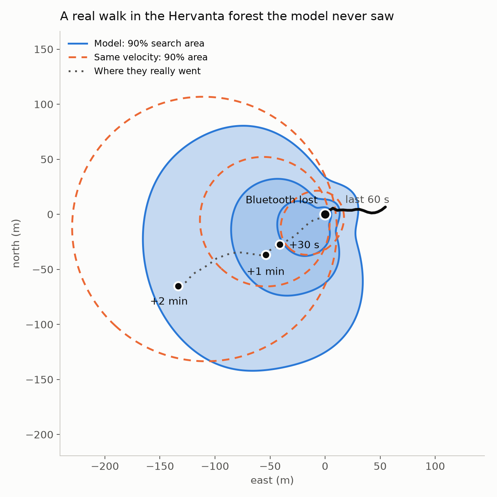
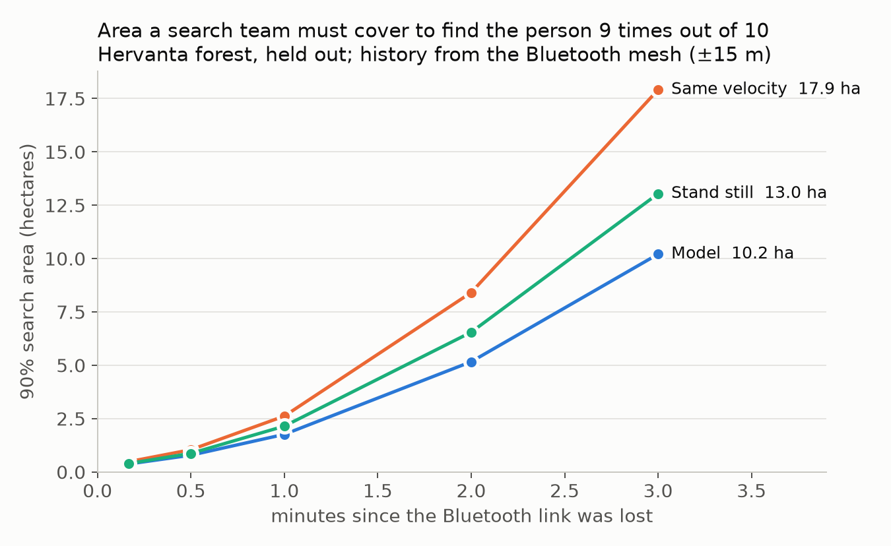

# Movement model: where did they go when Bluetooth lost them?

When a phone drops out of Bluetooth range of every other phone, the mesh has
nothing new to say about it, and the map freezes the dot where it was last
heard. The **route model (v3, current)** predicts which way the person went
along the path network, as 2–4 routes with percentages:

```
A 65%  Straight on at the fork in 240 m   ● probably ≈ 270 m along by now
B 10%  Left at the fork in 300 m          ●
C 10%  Back at the fork in 240 m          ●
D 10%  Right at the fork in 400 m         ●
       Left the paths: 4%
```

Try it: `demo/index.html` (published as an interactive page), with real walks
from the held-out Hervanta forest and what really happened next.

## Route model (v3)

How it works, from where people really walk:

1. **Path graph** (`fetch_graph_pbf.py`, `graph.py`): walkable OpenStreetMap
   ways from the Geofabrik Finland extract, with junctions closer than 8 m
   merged into one decision point. Hervanta: 15,766 junctions and dead ends,
   23,083 segments.
2. **Real walks snapped to the paths** (`pieces.py`, `match.py`): ~112 h of
   public GPS walks, matched with a Viterbi that only moves along connected
   paths or off them. 75–98% of walking matched to a path; 2,571 junction
   choices to learn from in eight areas, 619 to test on in Hervanta.
3. **Which way at a fork** (`route_features.py`, `choice.py`): a conditional
   logit with 14 readable weights (turn angle, U-turn, same path continues,
   path type, dead end, named, length, marked hiking route, and **how many
   other people walked each branch**). Popularity is always counted from walks
   on *other days* (two folds by date), so a walk never counts towards itself.
   Exported as per-junction turn tables (`export_routes.py`), so the phone only
   looks up probabilities.
4. **How far** (`route_stats.py`): measured distance walked by time t by
   recent pace, including stops (median after 10 min: 388 m if they had
   stopped, up to 705 m for brisk walkers), how often people turn back, and
   how often they leave the paths.
5. **Routes** (`runtime/route-model.js`): locate the person on the graph,
   follow every branch out to how far they could walk in 10 min, then group
   the branches into the routes that really differ, each with its percentage
   and a "probably here by now" marker with a 10–90% band.

### Results on Hervanta (held out)

At a fork (619 real choices, typically 3 ways to go):

| Which way | Picks the branch they took | Log-loss |
|---|---|---|
| Guess | 32% | 1.163 |
| Straightest way | 67% | 0.784 |
| Map model | 70% | 0.755 |
| **Map + where people walk** | **70%** | **0.741** |

Routes (849 moments from 17 walks on 8 days, clean GPS history; "right" =
within 20 m of the route line):

| | 2 min | 5 min | 10 min |
|---|---|---|---|
| **Top route right** | **67%** | **45%** | **26%** |
| **One of the shown routes right** | **89%** | **71%** | **43%** |
| Guessing at forks (top / any) | 51% / 73% | 24% / 39% | 11% / 18% |
| Straightest way (top / any) | 66% / 87% | 43% / 65% | 25% / 37% |
| **Closest "probably here" marker off by** | **38 m** | **95 m** | **201 m** |
| Same velocity / stand still | 58 / 80 m | 164 / 165 m | 340 / 263 m |

With a ±15 m Bluetooth-mesh history, one of the shown routes was right 75% /
59% / 36% of the time and the marker was off by 56 / 135 / 236 m (same
velocity: 88 / 220 / 448 m). All numbers: `results/metrics-routes.json`,
`results/choice-metrics.json`.

**Limits:**
- Only 17 Hervanta walks were long enough for 10-minute tests, from 8 days;
  the 90% interval for "top route right after 10 min" is 20–34%.
- "Keep going straight" is already a strong rule; the learned model adds a
  few points at each fork and better-calibrated percentages. Popularity adds a
  little: the OpenStreetMap traces cover few walks per path. More local walking
  data (the group's own past walks, a club's GPS tracks) is the obvious way to
  make "where people usually walk" count for more.
- People who leave the paths are only covered by the "left the paths" %.
- The walks come from people recording hikes, not lost people.

### Under 10 m: fusing the prediction with signals

No prediction alone can stay under 10 m for long: even an oracle that knows
the exact path a person took, and only has to guess how far along it they are
from their recent pace, is off by a median 2.5 m after 10 s, 6.9 m after
30 s, 12.9 m after 1 min and 54 m after 5 min on Hervanta. People change
pace and stop. Under 10 m minutes later needs new information, so
`runtime/route-filter.js` sharpens the route prediction with whatever
arrives after the link drops:

- **Bluetooth readings** of the lost phone (GhostCore `PeerObservation`),
  through MeshCore's outdoor path-loss model (-59 dBm at 1 m, exponent 2.5,
  5 dB).
- **The lost phone's own steps and compass** (GhostCore `MotionRecord`),
  synced when it is heard again. The steps move particles along with each
  particle's own guess of compass bias and step length; the map weighs them
  (on a path is likely, off a path stays possible), which calibrates the
  compass against the paths.

Held-out Hervanta, 849 moments, signals simulated from the real walks
(`runtime/eval-fusion.mjs`, `results/metrics-fusion.json`), median error:

| What the app knows after the link drops | 2 min | 5 min | 10 min | Under 10 m (5 min) |
|---|---|---|---|---|
| Nothing (route model) | 42 m | 141 m | 274 m | 4% |
| One Bluetooth reading | 18 m | 23 m | 29 m | 20% |
| Heard by phones nearby for 1 min | 10 m | 10 m | 12 m | 49% |
| **Its own steps (synced)** | **4.8 m** | **5.2 m** | **5.3 m** | **81%** |
| **Steps + one Bluetooth reading** | **4.8 m** | **5.1 m** | **5.1 m** | **83%** |

Simulated phones had ±6% step length and a ±7° compass bias that drifts. With
a worse phone (±15°, ±10%) the median stayed at 6–8 m, but the 95% radius
held only 73–84% of the time instead of 85–92%. Bluetooth alone is limited by
signal noise to about 10 m; UWB ranging would do better. Real signals are
the next test.

**Not yet in the app (25 Oct 2026).** Neither the route model nor this filter
runs in the iPhone app yet. The app (`ghostcore/release`, PR #12) shows the
v2 area model without the map (`MovementPredictor.readsMap = false`).
`runtime/RouteModel.swift` and `runtime/RouteFilter.swift` are ready as
standalone files and match the JS on their golden cases
(`test-golden-routes/`, `test-golden-filter/`: identical to the metre, ~5 ms
to replay 5 minutes with 300 particles). Whether and when they go into a
build is the GhostCore integration lead's call. Letting the lost phone log
its own `MotionRecord`s while out of range and relay them when it is heard
again also touches the mesh contract and wire format, so that is a team
decision too.

```js
import { createRouteFilter } from './route-filter.js';
const f = createRouteFilter(rp);                     // rp from createRoutePredictor
const s = f.start(hist, accuracy);                   // when the link drops
f.advance(s, 40);                                    // seconds since then
f.observeBluetooth(s, { listener: [x, y], listenerAcc: 5, rssi: -78 });
f.observeSteps(s, { dx, dy, seconds: 10 });          // pedometer displacement since the last call
const { center, r95, cloud } = f.estimate(s);
```

```swift
let f = RouteFilter(routes, particles: 400)               // routes: a RouteModel
var s = f.start(history: hist, accuracy: 12)              // when the link drops
f.advance(&s, to: 40)
f.observeBluetooth(&s, listener: p, listenerAcc: 5, rssi: -78)
f.observeSteps(&s, dx: dx, dy: dy, seconds: 10)
let est = f.estimate(s)                                   // est.center, est.r95, est.cloud
```

### Using it

```js
import { createRoutePredictor } from './route-model.js';
const rp = createRoutePredictor(await (await fetch('route-model.json')).json(),
                                await (await fetch('graphs/hervanta.json')).json());
const pred = rp.predictRoutes(hist, accuracyMeters);   // once, when the link drops (~1 ms)
for (const r of pred.routes) console.log(`${Math.round(100 * r.p)}% ${r.text}`);
const now = rp.whereAlong(pred, secondsSinceHeard);    // markers: now[i].point, now[i].band
```

iPhone: add `runtime/RouteModel.swift` (with `runtime/MovementModel.swift`),
`export/route-model.json` and `export/graphs/hervanta.json` to the target. It
takes the same input as the v2 model and matches the JS on the golden cases
(`runtime/test-golden-routes/main.swift`); on a laptop the 4 MB graph loads in
~0.1 s and a prediction takes ~0.1 ms.

```swift
let routes = try RouteModel(model: Data(contentsOf: routeModelURL), graph: Data(contentsOf: graphURL))
let track = reports.map { r -> MovementModel.TrackPoint in
    let p = routes.toXY(lat: r.latitude, lon: r.longitude)
    return MovementModel.TrackPoint(t: r.time, x: p.x, y: p.y)
}
let pred = routes.predict(track: track, now: track.last!.t, accuracy: lastAccuracy ?? 15)   // once
let markers = routes.whereAlong(pred, seconds: now - track.last!.t)                         // every second
for (r, m) in zip(pred.routes, markers) {
    print("\(Int(100 * r.p))% \(r.text)", routes.toLatLon(m.point))   // r.line for an MKPolyline
}
```

`hist` is 31 positions, 2 s apart, oldest first, in the graph's metre frame
(`toXY(lat, lon, {lat0, lon0})` from `movement-model.js`; the graph JSON
carries `lat0`/`lon0`). Graph and model files: `export/graphs/`,
`export/route-model.json`. Rebuild: `fetch_graph_pbf.py`, `graph.py`,
`pieces.py`, `match.py`, `route_stats.py`, `choice.py`, then
`export_routes.py --weights results/choice-pop.json --pop data/popularity/<area>-fold0.json`
and `node runtime/eval-routes.mjs` after `export_routes.py --eval`.

## Area models (v1, v2)

The earlier models predict a growing cloud instead of routes. v2 reads three
things the phone already has when the link drops:

1. **How they moved**: the last 60 s of positions (speed, turns, stops).
2. **The map around them**: paths, roads and lakes from OpenStreetMap, as a
   48 x 48 patch (480 m) rotated to the walking direction. It sees forks
   ahead, roads to the side and water in the way.
3. **Their plan**, if known: the direction and distance to where they were
   heading (a navigation target, a trailhead, a hut).

It runs on the phone with no internet: 88,980 numbers, **about 1 ms per
prediction** in plain Swift, no Core ML. The same files run in the browser.
The v2 demo is `demo/area.html`.

### v2 results

Trained on ~110 h of public GPS walks from eight Finnish areas (Nuuksio,
Sipoonkorpi, Repovesi, Seitseminen, Helvetinjärvi, Kauppi, Pyynikki,
Keskuspuisto). Tested on the **Hervanta forest, which the model never saw**
(14 h of real walking, 6,905 test cases).

"90% area" is the area a search team must cover to find the person 9 times out
of 10 in Hervanta. Every method is held to exactly that hit rate, so smaller is
better. The second number is the median distance between the single best
guess and where the person really was. The simple guesses ("stand still",
"same velocity") were tuned on the same training walks.

**History from the Bluetooth mesh (±15 m)**, the case this model is for:

| Time since lost | Model v2 (map) | v1 (history only) | Best simple guess |
|---|---|---|---|
| 30 s | **0.72 ha**, 24 m | 0.95 ha, 28 m | 1.06 ha, 29 m |
| 1 min | **1.85 ha**, 37 m | 2.34 ha, 44 m | 2.83 ha, 47 m |
| 2 min | **5.41 ha**, 64 m | 6.56 ha, 73 m | 8.37 ha, 85 m |
| 3 min | **10.9 ha**, 89 m | 12.1 ha, 100 m | 16.3 ha, 121 m |

With a mesh-quality history the map cuts the search area by **18–24% compared
with v1** up to 2 minutes (10% at 3 minutes), and by about a third compared
with the best simple guess. The noisier the history, the more the map helps:
a ±15 m track does not say which of two parallel paths someone is on, and the
map does.

**History from the phone's own GPS (±4 m):** the map helps less (4–8% less
area than v1 from 1 minute on; 4.09 vs 4.45 ha at 2 minutes) because a clean
track already shows which path the person is on. Here v2 also has a worse
log-likelihood than v1: it is sometimes confidently wrong when people leave
the mapped paths.

**Told where they were going** (the same model, on the 82% of test walks whose
end was known):

| Time since lost | Mesh history: without → with destination | Clean GPS history: without → with |
|---|---|---|
| 1 min | 1.82 → **1.65 ha** (37.6 → 35.5 m) | 1.10 → **1.01 ha** |
| 2 min | 5.21 → **4.55 ha** (65.8 → 58.8 m) | 3.95 → **3.54 ha** |
| 3 min | 10.5 → **8.87 ha** (91.8 → 80.4 m) | 8.37 → **7.23 ha** (80.5 → 72.5 m) |

A destination matters more the longer the person has been gone: 8–13% less
area at 1–2 minutes, 14–15% at 3 minutes. All numbers are in
[`results/metrics-v2.json`](results/metrics-v2.json) (`area90_exact`, `err50`).

**Limits, worth saying in the pitch:**
- In training, "destination" is where each walk really ended. That stands in
  for a target set in the app; real plans change, so treat it as a best case.
- The walks come from people who recorded their hikes, not from people who
  were lost. Lost people tend to follow trails, streams and other lines in the
  terrain.
- On a phone you have to fix the 90% line in advance. Lines set on the
  training forests held the person 77–85% of the time in Hervanta for v2 with
  mesh history (v1: 83–87%): the map makes the model sharper, and a little
  overconfident in a forest it has not seen. A deployment would widen the line
  or calibrate per region.

v1 figures:  

## Which map

- **For the model: OpenStreetMap**, bundled in the app as a small image per
  region (Hervanta: 957 x 862 px, 668 kB, `export/maps/`). It works offline,
  which matters because when GPS is jammed in a forest, mobile data is often
  gone too. OpenStreetMap's licence (ODbL) allows this with attribution.
- **For people to look at: Apple Maps (MapKit)** in the iPhone app, free and
  native, with the predicted cloud drawn on top (`toLatLon` converts back).
- **Not Google Maps**: its terms forbid using its map data to train models or
  derive data from it, it needs an API key with billing, and it cannot be
  bundled offline.

## What the phone should keep doing

The model can only use what the phone recorded before the link dropped:

- Keep its own track at about 1 Hz (positions and their accuracy), the last 60 s
  at least. Without GPS that is the mesh estimate with its `accuracyMeters`.
- If the person set a destination, include it in the mesh position report
  (an optional `destination` in the same frame), so the phones that lose them
  know where they were heading.
- Ship the map image for the region the group is in, before going out.

## Using the area model (v2)

Positions are metres. With the map they must be in the map's frame:
`toXY(lat, lon)` converts GPS coordinates, `toLatLon` converts back. Without a
map any flat frame works (the demo room's x/z), and the model behaves like v1.
`accuracy` is how far off the history positions may be: about 5 m for a
phone's own GPS, the mesh's `accuracyMeters` for a lost phone.

### iPhone (Swift)

Add `runtime/MovementModel.swift`, `export/movement-model-v2.json`,
`export/maps/hervanta.png` and `export/maps/hervanta.json` to the Xcode target.

```swift
let model = try MovementModel(json: Data(contentsOf: Bundle.main.url(forResource: "movement-model-v2", withExtension: "json")!))
let map = try MovementModel.MapLayer(png: Data(contentsOf: Bundle.main.url(forResource: "hervanta", withExtension: "png")!),
                                     meta: Data(contentsOf: Bundle.main.url(forResource: "hervanta", withExtension: "json")!))

// When the link drops: this person's last reports, oldest first.
let track = reports.map { r -> MovementModel.TrackPoint in
    let p = map.toXY(lat: r.latitude, lon: r.longitude)
    return MovementModel.TrackPoint(t: r.time, x: p.x, y: p.y)
}
let hist = model.history(track: track, now: track.last!.t)
let goal = destination.map { map.toXY(lat: $0.latitude, lon: $0.longitude) }
let prep = model.prepare(history: hist, accuracy: lastAccuracy ?? 15, map: map, destination: goal)   // ~1 ms, once

// Then every second while they are missing:
let pred = model.predict(prepared: prep, horizon: now - track.last!.t)
let dots = pred.sample(300).map { map.toLatLon($0) }      // MapKit annotations or an overlay
```

### Dashboard / web (JavaScript or TypeScript)

```js
import { createMovementModel, createMapLayer, historyFromTrack, toXY, toLatLon } from './movement-model.js';
const model = createMovementModel(await (await fetch('/movement-model-v2.json')).json());
const meta = await (await fetch('/maps/hervanta.json')).json();
const img = await createImageBitmap(await (await fetch('/maps/hervanta.png')).blob());
const g = new OffscreenCanvas(meta.width, meta.height).getContext('2d');
g.drawImage(img, 0, 0);
const map = createMapLayer(g.getImageData(0, 0, meta.width, meta.height).data, meta, 4);

const track = reports.map((r) => { const [x, y] = toXY(r.lat, r.lon, meta); return { t: r.time, x, y }; });
const prep = model.prepare(historyFromTrack(track, track.at(-1).t, model.spec), accuracy, { map, destination });
const pred = model.predictPrepared(prep, secondsSinceHeard);
for (const [x, y] of model.sample(pred, 300)) drawDot(toLatLon(x, y, meta));
```

Past 3 minutes the model clamps to 3 minutes.

## How the area model works

- **Walks** (`fetch_osm.py`, `prepare.py`): public, timestamped GPS traces from
  the OpenStreetMap API for nine Finnish areas. Cut at gaps, GPS spikes
  dropped, resampled to 1 s, anything moving faster than 2.6 m/s for 30 s
  (bikes, cars, runners) removed with a minute of margin, stops kept. ~126 h
  of walking, 14 h of it the Hervanta test set. Each moment also records where
  that walk ended (the destination stand-in).
- **Map** (`fetch_map_pbf.py`, `rasterize.py`): paths, roads and lakes cut from
  the Geofabrik Finland extract with pyosmium (lakes assembled with their
  islands), drawn at 8 m per pixel in each area's metre frame (`geo.py`).
  (`fetch_map.py` does the same through the Overpass API, which was too
  overloaded to rely on.)
- **Model** (`model2.py`): v1's history features, the destination (direction,
  log distance, a flag), a map flag, and the map patch through 4 convolution
  layers into 64 numbers; then 3 x 128 layers to a mixture of 6 Gaussian blobs
  scaled by how far a walker can get in `h` seconds.
- **Training** (`train2.py`): the history is corrupted the way the mesh would
  corrupt it (correlated error up to 25 m), randomly rotated and mirrored,
  sometimes shortened; the map patch and destination go through the same
  transform. The destination is shown half the time and the map is hidden 10%
  of the time, so the model also works without them. 30,000 steps of 512, about
  15 min on the laptop's GPU.
- **Checks**: `export/golden-v2.json` holds 24 cases predicted by PyTorch on
  the Hervanta map; the JS and Swift runtimes match them, including reading
  the map patch (`test-golden-v2.mjs`, `test-golden-v2/main.swift`). v1 still
  loads and passes `golden.json`.

## Reproduce

```sh
python3.12 -m venv .venv && .venv/bin/pip install -r ml/requirements.txt
.venv/bin/python ml/fetch_osm.py           # walks, ~10-30 min, polite to the OSM API
.venv/bin/python ml/prepare.py
curl -L -o ml/data/finland.osm.pbf https://download.geofabrik.de/europe/finland-latest.osm.pbf
.venv/bin/python ml/fetch_map_pbf.py && .venv/bin/python ml/rasterize.py
cd ml
STEPS=30000 ../.venv/bin/python train.py && ../.venv/bin/python export.py     # v1 (v2 compares against it)
STEPS=30000 ../.venv/bin/python train2.py && cp runs/v2-latest/metrics.json results/metrics-v2.json
../.venv/bin/python export2.py && ../.venv/bin/python demo/build.py
node runtime/test-golden-v2.mjs
swiftc -O runtime/MovementModel.swift runtime/test-golden-v2/main.swift -o /tmp/mm-test-v2 && /tmp/mm-test-v2 export
```

Walks: public GPS traces © OpenStreetMap contributors. Map data ©
OpenStreetMap contributors, ODbL.
